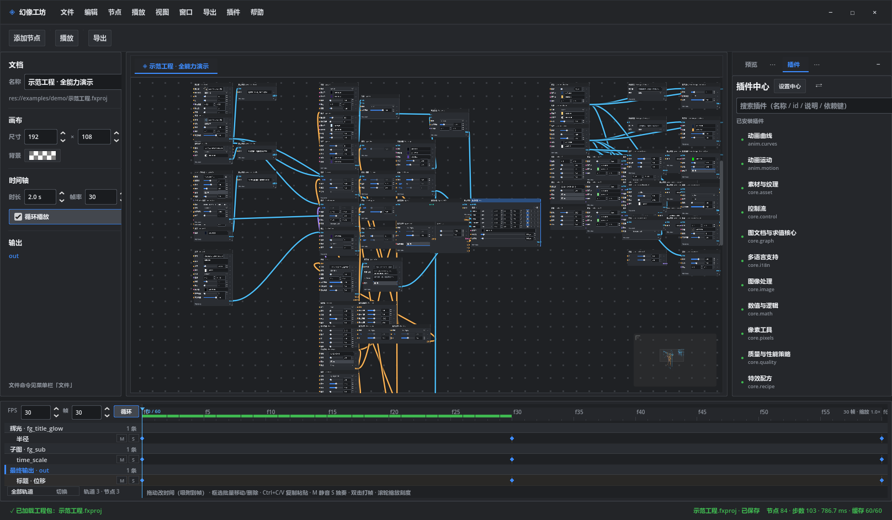
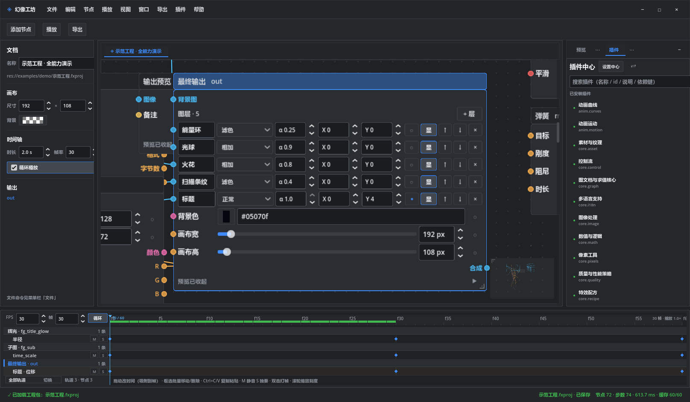
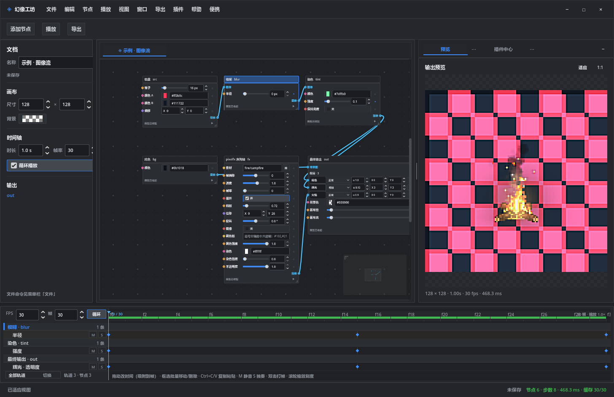
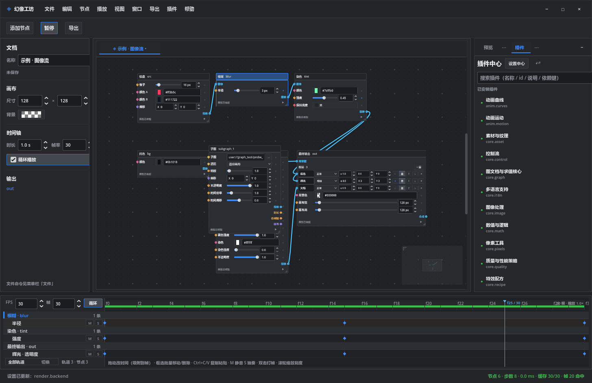
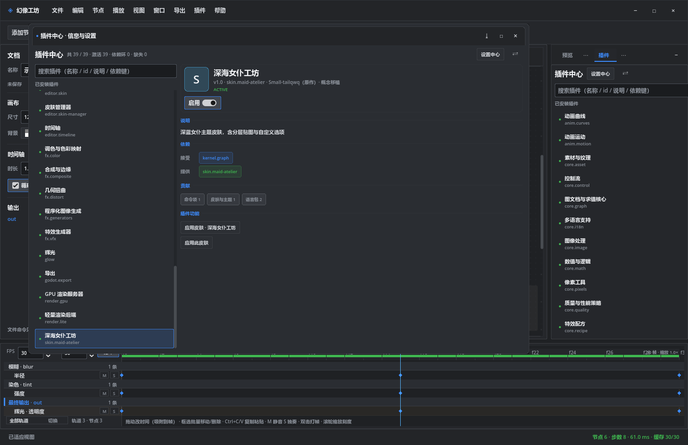
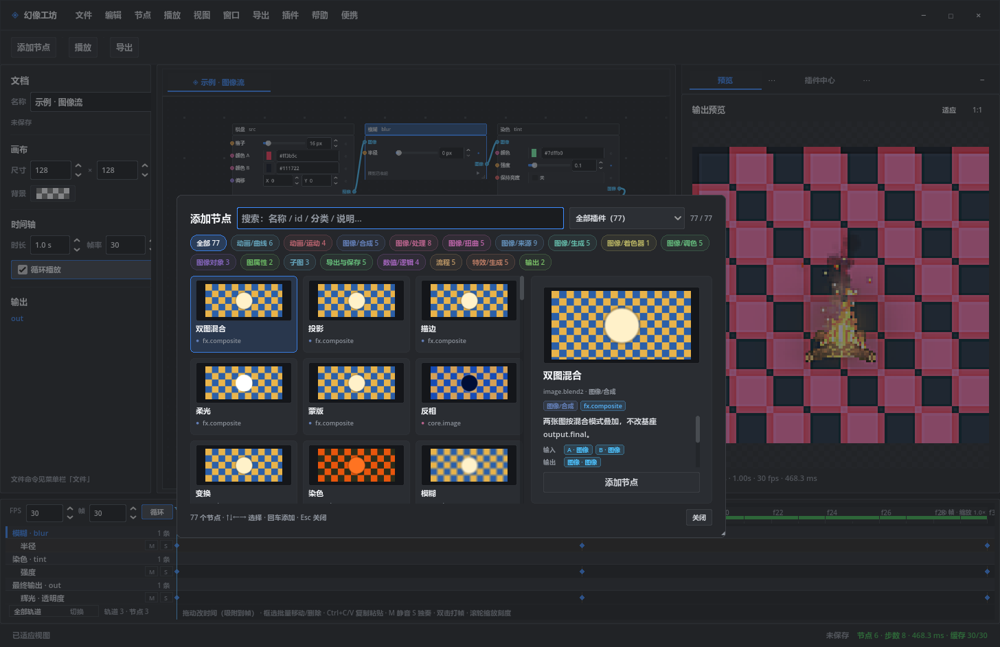
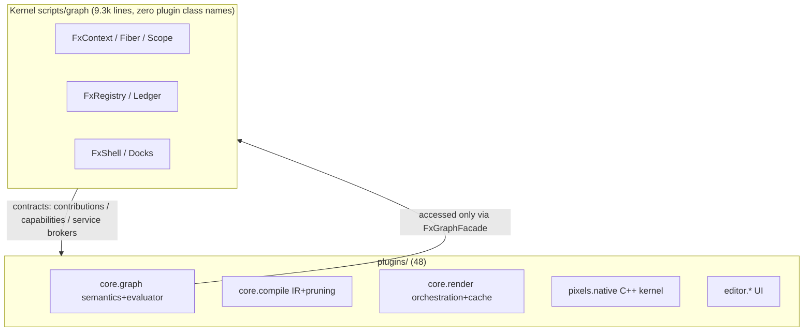

<div align="center">


# Phantom Workshop

**A node-based 2D effects workshop with a microkernel and everything-as-a-plugin**


<sub>[简体中文](README.md) · **English**</sub>

</div>

> **Current state: `0.0.20-alpha` (first test build).** Not production ready: APIs, file
> formats and performance will change. There is no official binary — run it from source;
> the app is its own editor. Every GitHub Release is published as a **pre-release**;
> there is no "latest stable".
>
> This version is about **making the claims accurate**: every number is read from the code by
> `python tools/check_docs.py`, which exits non-zero when a document disagrees. When docs and
> code differ, the script wins.

## What it is

A **2D effects compositor** on Godot 4.7: wire nodes into a graph, animate it on a timeline,
see the result live, export to video or image sequences.

What sets it apart is not "it has nodes" but that **the application is detachable**:

| Layer | Where | Size | Responsibility |
| --- | --- | --- | --- |
| **Kernel** | `scripts/graph/` | 9.3k lines | context and effect scopes, component/fiber lifecycle, registry and ledger, settings, service brokers, shell and docks |
| **Plugins** | `plugins/` | 31k lines / 42 | graph semantics, evaluator, IR compiler, render orchestration, GPU backend, native pixel kernel, operator library, blueprint editor, timeline, skins, exporters, locales, diagnostics |

The kernel contains **no plugin class names** — `--fx-run=diag.blame` reports this fact
(currently 0 kernel findings). Remove `plugins/core.render/` and it still boots: you get an
empty presenter — no picture, but every menu and panel is there.

## Paradigm: it organises the boundaries, it is not an equivalent implementation

Designed after *[A Programming Paradigm for Spatiotemporal Composability](https://arxiv.org/abs/2608.25512)*:
**space** (dependency declaration and reaction) and **time** (revertible side effects)
evolve independently and meet only at composition points.

**What actually holds in the code** (each row maps to a file):

| Paper | Where |
| --- | --- |
| Coeffect context Σ (key → value / key → provider) | `FxContext.values` / `providers` |
| Satisfaction `σ ⊧ d` | `FxContext.satisfies()` |
| Notification trichotomy (activating / deactivating / neutral) | `FxFiber.refresh()` |
| Witnessed effects with a LIFO inverse stack | `FxEffectScope.add(inverse)` |
| Component =(d, p, e); fibers with retire | `FxComponent` / `FxFiber` |
| Declarative loader + config reconciliation + hot reload | `FxPluginHost` / `plugins.cfg` |

**What is explicitly not done** (so nobody relies on the paper's strong guarantees):

1. **No value equivalence `≃ₖ`.** `set_value()` / `provide()` notify on every write without
   comparing. Notifications — and therefore downstream rebuilds — are more frequent than needed.
2. **`set` has no "key not already bound" precondition.** Last writer wins; this is how
   `render.gpu` overrides `image.blur`. Provision exclusivity does not hold.
3. **No isolation / interception / derived contexts.** The context is a flat table: you cannot
   bind different values of one key for two components, nor intercept dependency access.
4. **Temporal composability holds only for UI/services.** Graph and operator state is torn down
   by `reset_runtime_tables()`, not by replaying inverses.

In one line: **the paradigm is the basis for the boundaries, not a fulfilled mathematical promise.**

## Quick start

```bash
git clone https://github.com/QiNuoTu/phantom-workshop-Harness.git
cd phantom-workshop-Harness
godot --path .                     # launches the workbench (scenes/main.tscn)
```

The native pixel kernel is an **optional accelerator**; without it everything falls back to
GDScript (same output, slower):

```bash
# needs godot-cpp sources + MSVC. Skipping it costs speed, not features.
bash plugins/pixels.native/build.sh template_debug
```

The look-dev pack (`fx.keying` / `fx.channels` / `fx.masks` / `fx.tone` / `fx.stylize`,
29 operators) has **no GDScript fallback** — the operators only exist in C++
(`plugins/fx.native-kit`). Without this build those five plugins stay inactive and their
nodes never appear (`diag.blame` says so explicitly):

```bash
bash plugins/fx.native-kit/build.sh template_debug
```

```bash
bash tools/run_tests.sh            # 25 suites / 1693 assertions (0 failed, 0 abnormal exits, incl. operator budget gate)
python tools/check_docs.py         # docs vs code (CI; non-zero means drift)
```

## Interface

<table>
  <tr>
    <td></td>
    <td></td>
  </tr>
  <tr>
    <td align="center"><sub><b>Workbench</b>: node library, blueprint, inspector, timeline</sub></td>
    <td align="center"><sub><b>Node cards</b>: typed ports, params, live readouts of this frame</sub></td>
  </tr>
  <tr>
    <td></td>
    <td></td>
  </tr>
  <tr>
    <td align="center"><sub><b>Cache band</b>: green = exact cached frame, yellow = placeholder</sub></td>
    <td align="center"><sub><b>Playback</b>: the playhead only reads the cache</sub></td>
  </tr>
</table>

<table>
  <tr>
    <td></td>
    <td></td>
  </tr>
  <tr>
    <td align="center"><sub><b>Plugin hub</b>: dependencies, capabilities, settings, toggle for all 48 plugins</sub></td>
    <td align="center"><sub><b>Add node</b>: 105 nodes in 22 categories, each card is a live thumbnail</sub></td>
  </tr>
</table>

## Plugin map

| Group | Plugins | Provides |
| --- | --- | --- |
| **Kernel capabilities** | `core.graph` `core.compile` `core.render` `core.quality` `core.timeline` `core.control` `core.i18n` | graph semantics + evaluator, IR compile + pruning, render orchestration + frame cache, quality policy, clock, palette, locales |
| **Pixels** | `core.pixels` `core.image` `core.source` `core.text` `core.asset` `core.recipe` `core.shader` | blend/resample utilities, image ops, generators, text raster, pixelfx assets, recipe engine, shader nodes |
| **Acceleration** | **`pixels.native`** `render.gpu` `render.lite` | five C++ operator families (GDExtension), GPU compute backend, pure CPU backend |
| **Operators** | `core.math` `fx.color` `fx.composite` `fx.distort` `fx.generators` `fx.vfx` `glow` `anim.curves` `anim.motion` `fx.keying` `fx.channels` `fx.masks` `fx.tone` `fx.stylize` | maths and logic, colour, compositing, distortion, generators, VFX, glow, curves, motion, keying, channels, masks, tone, stylize — the 106 nodes live in this range |
| **Editor** | `editor.document` `editor.graph` `editor.preview` `editor.timeline` `editor.node-picker` `editor.palette` `editor.plugin-hub` `editor.plugins` `editor.settings` `editor.skin` `editor.skin-manager` `editor.help` `editor.dropimport` `editor.diagnostics` | document + undo, blueprint view, output preview, timeline, node picker, palette, plugin hub, settings, skins, help, drag-import, blame diagnostics |
| **Look / output** | `skin.maid-atelier` `godot.export` | skins, exporters (video / frame sequences / PNG) |

Writing a plugin means **adding a directory**, not editing the shell —
see [Plugin development](docs/插件开发.md) (Chinese).

## Architecture



Three hard rules, all machine-checked:

1. **Zero plugin class names in the kernel** — `test_architecture` whitelist + `diag.blame` structural scan.
2. **Graph semantics live only in `core.graph`**; the kernel goes through `FxGraphFacade.access()`.
   Node types live in `nodes*.json` + the operator table, never hard-coded.
3. **The presenter is a contract, not an implementation** — `FxRenderHost` is an empty
   implementation that `core.render` extends; look ids are not hard-coded.

Details: [docs/架构.md](docs/架构.md) (Chinese).

## Cache, preview, pruning

The **frame cache** is the core asset: a correct frame goes to disk (`frames.fxc`, 64B header +
fixed-size RGBA8) and playback only reads it.

- **Buckets are keyed by content identity**, not by notifications:
  `content_key() = generation × 2²⁰ + content revision`. Dragging nodes, resizing groups and
  changing selection are **not content** — no bucket change, no repaint.
- **Invalidation has three tiers**: `content` (rebuild bucket) / `derived` (drop derived tables
  and thumbnails, keep exact frames) / `display` (drop only the display layer). Settings declare
  their tier via `impact` (26 runtime settings annotated).
- **Two preview pipelines**: node thumbnails may lower operator quality (0.5 by default), the
  output preview is always exact. Exactness is decided by the quality tier that produced the
  frame (`frame_quality`), not by "is it playing right now".
- **The canvas size has exactly one home** (`meta.canvas`): `frames.fxc` is a fixed-stride
  file, so the frame size *is* its layout — a document that says 192 while a node says 256
  gets every frame dropped by the size gate. The width/height sliders on the output node are
  a **view** of that value (declared via `binds`): editing them edits the document canvas.
  Bucket / store-fetch / publish each enforce the size independently. See [architecture](docs/架构.md) §5.1.
- **Pruning in two layers**: pull-based evaluation never touches unreachable nodes; `core.compile`
  then compiles the graph into a pure-data plan (order / live / dead / sinks / constants /
  type errors / frame segments). Demo project: **Live 85 / Dead 18**, 2 folded constants.

> Be careful with the wording: Dead 18 is a **structural upper bound**, not a speed-up.
> Pull-based evaluation already skips dead nodes; the real wins are constants folding steps 3→2,
> sinks going from O(N) to O(#sinks), and observability.

## Performance

Fixed measurement setup: **`examples/demo/示范工程.fxproj`, 103 nodes, 192×108, 60 frames, headless.**
Numbers from other setups are not comparable.

| Metric | Value | Notes |
| --- | --- | --- |
| Frame | **69.0 ms** | measured 2026-11-17, `tests/_profile_frame.gd` |
| Operators | 44.1 ms (64%) | 97 calls, 0.45 ms average |
| Framework/other | 24.9 ms (36%) | port table, param resolution, subgraph runners, preview capture |
| Most expensive | `graph.subgraph` 13.3 ms | 2 calls, 3.55 ms of which is inside the subgraph |

History: pure GDScript 555 ms → row-parallel 344 ms (1.61×) → native kernel 226 ms (2.46×)
→ now 69 ms (**8.0×** vs the start).

Two optional accelerators, both may be absent:

- **Native pixel kernel** (`pixels.native`, GDExtension): 5 classes / 25 generic primitives, it
  knows no node types. Absent or disabled → GDScript fallback; `tests/test_pixel_native.gd`
  guards precision by running the same operator with the switch off and on and comparing bytes
  (97 assertions).
- **GPU compute** (`render.gpu`): blur, mix, sharpen, outline; worker threads join through
  `RenderingServer.call_on_render_thread`. **Main evaluation is still CPU.**

Per-layer resolution (`res_scale`) is the only double-digit-percent switch: 2.40× at 0.5,
3.59× at 0.25 (192²).

## Diagnostics: find out whose fault it is

```bash
GODOT="D:/SteamLibrary/steamapps/common/Godot Engine/godot.windows.opt.tools.64.exe"

"$GODOT" --headless --path . -- --fx-diagnose                        # what exists
"$GODOT" --headless --path . -- --fx-diagnose --fx-run=diag.blame    # whose fault
"$GODOT" --headless --path . -- --fx-diagnose --fx-run=diag.cache    # who rebuilds
"$GODOT" --headless --path . -- --fx-diagnose --fx-run=diag.compile  # what the graph compiles to
```

`diag.blame` ends with `needs action: kernel N / plugin M / assembly K` — that line is the only
basis for action. Ownership now comes from a **declared scope**
(`FxBoot.error(where, msg, scope)` with `kernel` / `assembly` / `plugin:<id>`), not from guessing
by wording: the previous version classified "plugin directory missing a manifest" as a kernel bug.

See [docs/诊断与归因.md](docs/诊断与归因.md) (Chinese).

## Known gaps

| # | Goal | Status |
| --- | --- | --- |
| 1 | Rebuild only when data changes | **Core done.** Three gates + per-node signatures + downstream-closure diff invalidation: editing one parameter drops only it and its downstream, upstream entries keep hitting. |
| 2 | Preview on its own adjustable quality pipeline | **Partial.** `display_scale` (1.0/0.5/0.25) shrinks only the on-screen copy; archive frames and exports stay pixel-identical. Thumbnails still compute full-res then resize. |
| 3 | Runtime pruning | **Partial.** The IR plan feeds all three evaluation paths; exec-entry pruning, `evaluate_always` side branches, keyframe-free detection and per-frame port indexing are still open. |
| 4 | Entire pipeline in GDExtension | **Not started.** Native covers 25 primitives; the evaluation loop, param resolution, port conversion and Image allocation are still GDScript (that 36%). |
| 5 | Make the GDExtension a plugin | **Done.** `plugins/pixels.native/` is a real plugin: ships its library and descriptor, declares a capability, falls back when disabled. The assembly report says "5/5 families present". |
| 6 | Break up the monolithic CPP | **Done.** 1635-line monolith → five operator families + `common/` (2027 lines); 97 byte-exact assertions pass. |

## Documentation map

| Looking for | Go to (Chinese unless noted) |
| --- | --- |
| What actually holds in the code, where the boundaries are | [docs/架构.md](docs/架构.md) |
| Writing a plugin (manifest, contributions, discipline) | [docs/插件开发.md](docs/插件开发.md) |
| The four version numbers and when each moves | [docs/版本策略.md](docs/版本策略.md) |
| How performance is measured | [docs/性能口径.md](docs/性能口径.md) |
| "Whose fault is it" tooling | [docs/诊断与归因.md](docs/诊断与归因.md) |
| Where the project stands, what is next | [docs/路线与缺口.md](docs/路线与缺口.md) |
| Rules for AI collaborators (invariant list) | [CLAUDE.md](CLAUDE.md) |

## Layout

```
phantom-workshop/
├── scripts/graph/           # kernel (9.3k lines, zero plugin class names, checked by diag.blame)
│   ├── kernel/              # context, fibers, scopes, registry, settings, boot
│   ├── plugins/             # plugin host and contracts
│   ├── services/            # document store, clock broker, render broker
│   └── ui/                  # shell, docks, skins, widgets
├── plugins/                 # 48 plugins (each with plugin.json; pixels.native also has C++)
├── scenes/main.tscn         # main scene
├── tests/                   # 25 headless suites + display probes
├── tools/                   # test runner, docs checker, icon and art scripts
├── docs/                    # architecture, plugin dev, diagnostics, versions, performance, roadmap, look-dev pack
└── examples/demo/           # the demo project (only source of perf numbers)
```

## Contributing

See [CONTRIBUTING.md](CONTRIBUTING.md). Two things that bite everyone:

- After changing a `class_name`, run `--headless --editor --quit` to rebuild the global class cache.
- Before committing, both `bash tools/run_tests.sh` and `python tools/check_docs.py` must pass.

## License

MIT. Third-party assets and fonts: [THIRD_PARTY_NOTICES.md](THIRD_PARTY_NOTICES.md).
