<div align="center">

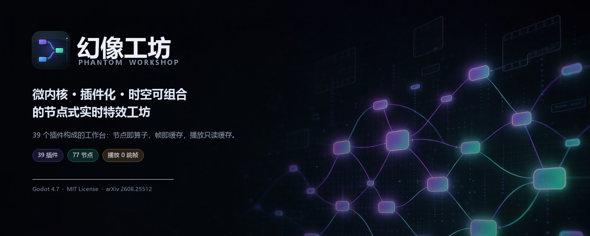

# Phantom Workshop

**A micro-kernel node compositor where everything is a plugin.**


<sub>**English** · [简体中文](README.md)</sub>

[Quick start](#quick-start) · [Screenshots](#screenshots) · [Plugin map](#plugin-map) · [Architecture](#architecture) · [Performance](#performance-on-a-real-project) · [Contributing](CONTRIBUTING.md)

</div>

---

## What this is

Phantom Workshop is a **2D effects compositor** running on [Godot 4.7](https://godotengine.org/):
wire nodes into a graph, let the graph move along a timeline, watch the result live, and export
it as video or an image sequence.

What makes it different is not "it has nodes" — it's that **the application itself is detachable**:

- The kernel is only **8.9k lines**: document undo stack, context/scope, registry and ledger,
  service brokers, shell and docking.
- Everything else is **39 plugins**: graph semantics, evaluator, render orchestration, GPU
  backend, operator library, blueprint editor, timeline, skins, exporters, language packs…
  Each one can be disabled, hot-reloaded, or swapped at runtime.
- **No plugin class name appears in kernel source.** Delete `plugins/core.render/` and the app
  still starts — it just gets an "empty renderer": no image, but menus, panels and shortcuts
  are all still there.

This is not architectural fussiness. It comes from a paper:

> **A Programming Paradigm for Spatiotemporal Composability**
> <https://arxiv.org/abs/2608.25512>

Its central claim is that **space and time must be orthogonal**: space (graph structure,
subgraphs, operators) and time (clock, frame index, cache) evolve independently and only meet
at a "composition point". This project is one complete implementation of that claim:

| Dimension | Owner           | In practice                                                                                                  |
| --------- | --------------- | ------------------------------------------------------------------------------------------------------------ |
| Space     | `core.graph`    | Documents, nodes, ports, links, subgraphs. The evaluator knows no UI; the editor knows no graph container.     |
| Time      | `core.timeline` | `FxPlaybackClock` only answers "should we advance?" — it knows nothing about graphs, caches or UI.             |
| Compose   | `core.render`   | The only place holding both "frame index" and "the graph for that frame"; playback reads the cache, never evaluates. |

There is no shared mutable state between the three — only broker contracts. That is why you can
swap the clock for a variable-speed or audio-driven one, swap the backend for a GPU, or replace
the editor with a different shape, without touching the other two.

---

## Screenshots

<div align="center">
  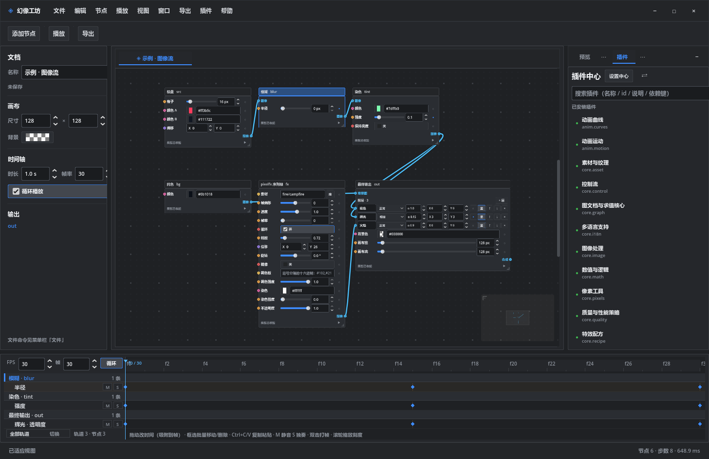
  <sub>Left: document &amp; canvas · Center: blueprint (node cards show that node's output for the current frame) · Right: preview and plugin hub · Bottom: timeline</sub>
</div>

<table>
<tr>
<td width="50%">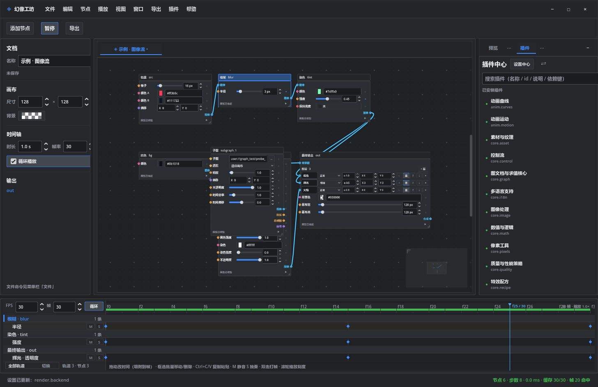
   <sub><b>Timeline</b>: the ruler is ticked in frames; the wheel zooms anchored at the cursor; the strip shows per-frame cache state</sub></td>
<td width="50%">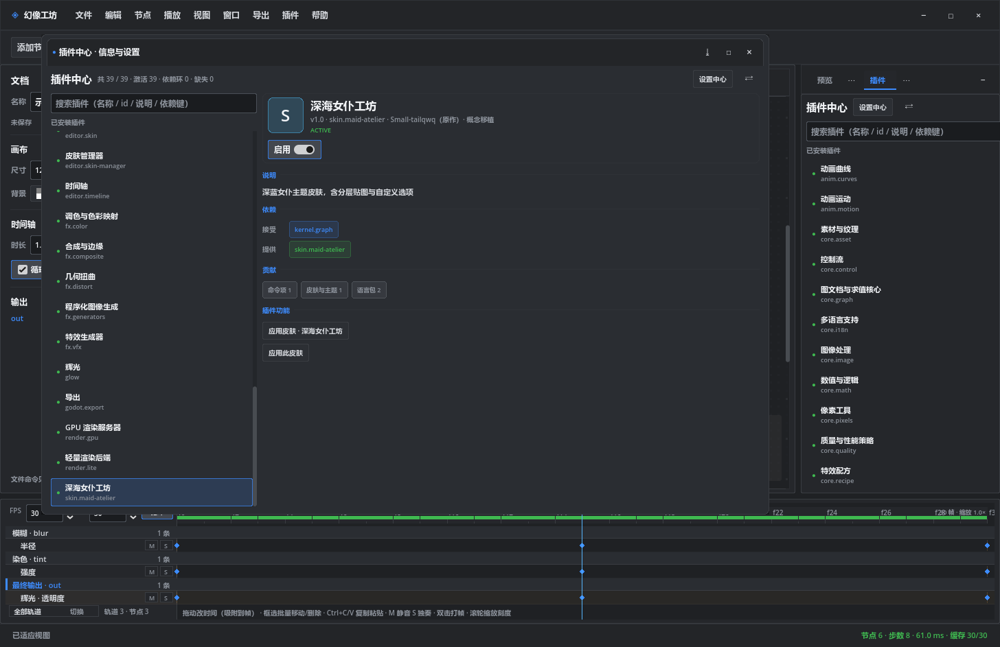
   <sub><b>Plugin hub</b>: state, dependencies, provided capabilities and settings for all 39 plugins, toggleable in one click</sub></td>
</tr>
<tr>
<td>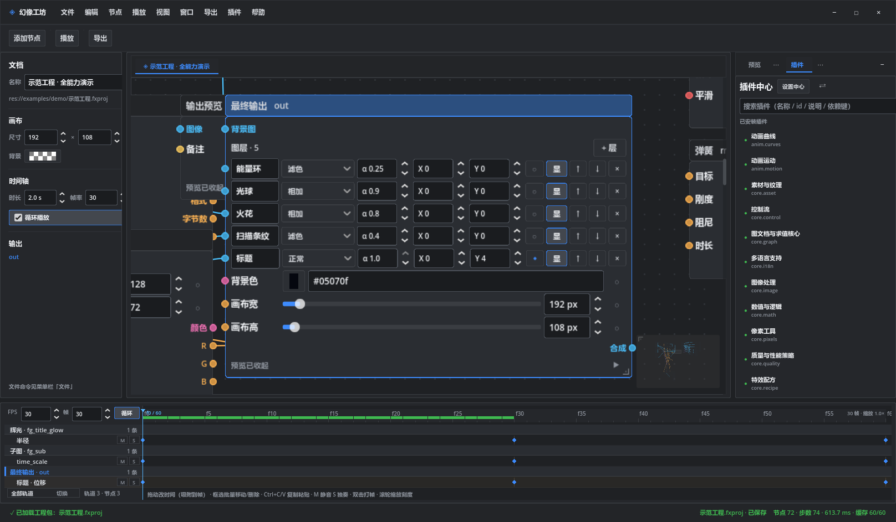
   <sub><b>Node cards</b>: expand one for a live thumbnail; the badge in the corner tells you whether that frame is baked (✓ / … / —)</sub></td>
<td>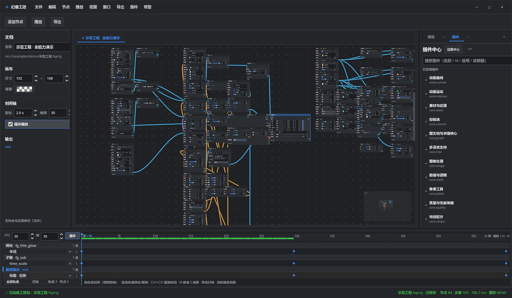
   <sub><b>Demo project</b>: 103 nodes / 81 links / 192×108 / 30 fps / 60 frames — the single benchmark for every number below</sub></td>
</tr>
<tr>
<td>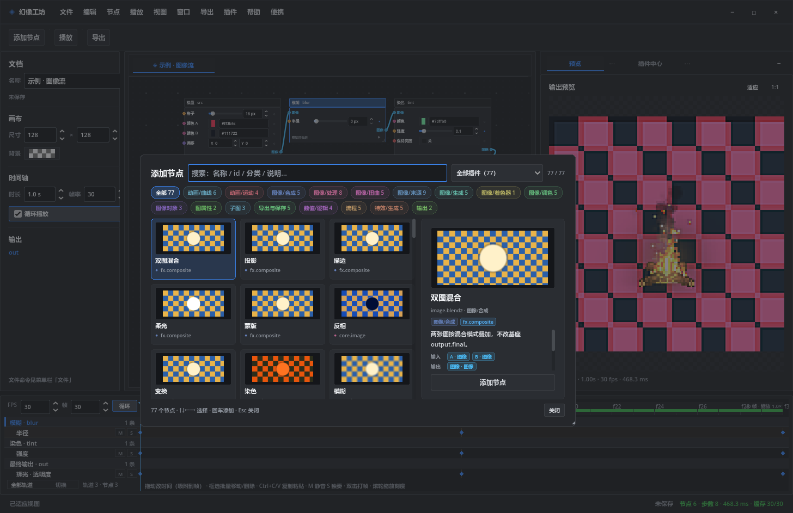
   <sub><b>Add node</b>: 77 nodes filed under 11 categories; each card is itself a live thumbnail, and the side pane shows ports and parameters</sub></td>
<td>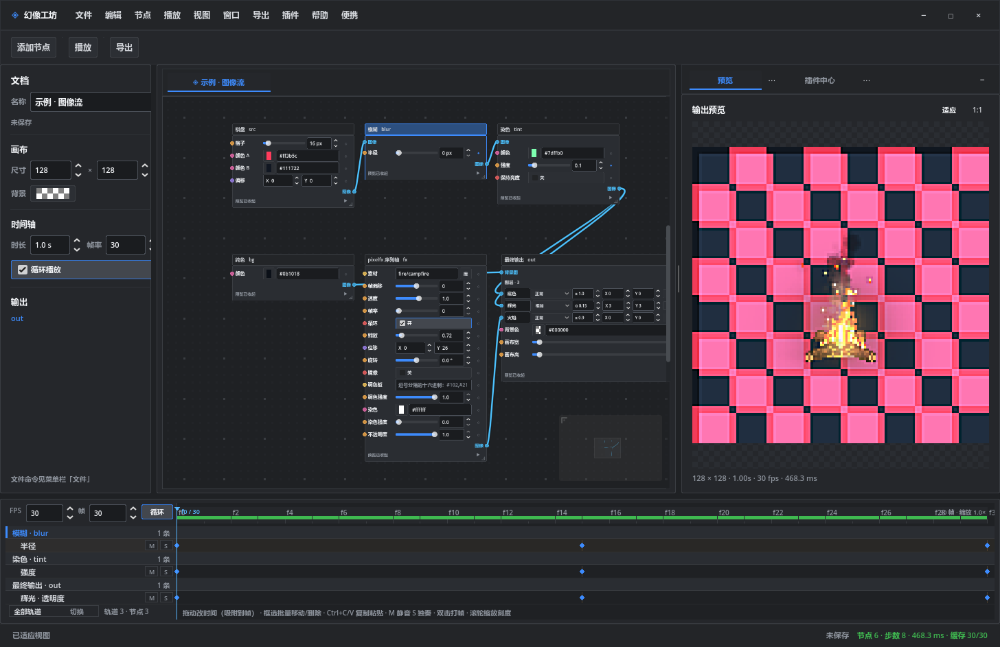
   <sub><b>Workbench</b>: inline parameter editing, ruler aligned to frames (f2 / f4 …), per-frame cache strip beneath it</sub></td>
</tr>
</table>

<div align="center">
  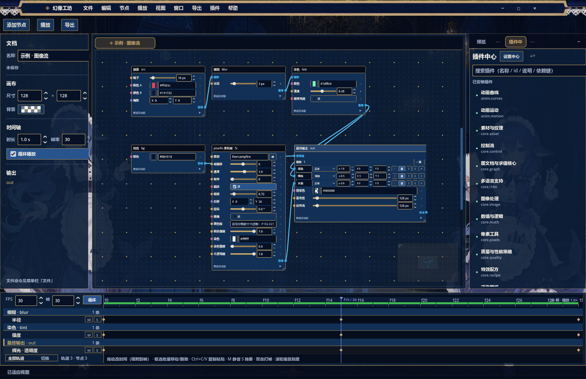
  <sub>A skin is not a recolour: panels, docking, node cards and ports are all repainted by a plugin (skin packs install and uninstall on their own)</sub>
</div>

---

## Highlights

<table>
<tr>
<td width="33%" valign="top">

**A detachable plugin system**

Node types, operators, export formats, parameter widgets, panels, windows, commands, menus,
skins, language packs, asset packs — all are contribution points. Hot reload unwinds LIFO;
disabling a plugin never leaves half a UI behind.

</td>
<td width="33%" valign="top">

**Playback only reads the cache**

Once a frame is computed it lands in a tight single file, `frames.fxc`: 64-byte header +
bitmap + fixed-stride RGBA8. Playback seeks one frame in about 0.1 ms — **0 skipped frames,
0 misses** — and the UI thread never evaluates anything.

</td>
<td width="33%" valign="top">

**A GPU render server**

Per-pixel operators are covered by compute shaders whose output is **byte-identical** to the
CPU path (pixel delta ≤ 0.0027). Blur is 6.4× faster, mixing 14.6×; without a graphics device
it falls back to CPU instead of failing.

</td>
</tr>
</table>

<div align="center">
  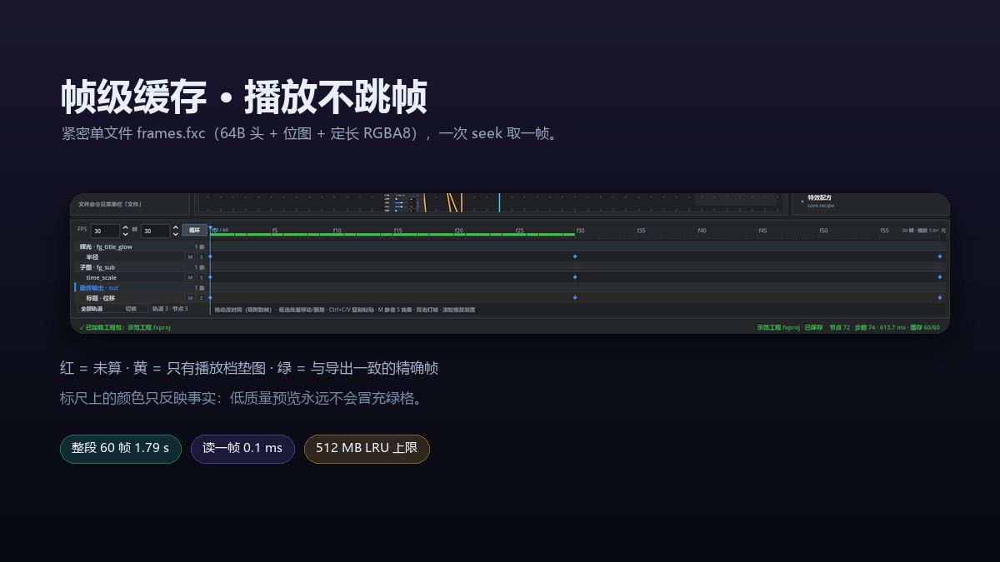
</div>

**Colour states a fact.** On the ruler, red = never computed, yellow = only a playback-tier
stand-in (viewable, but not exact), green = an exact frame, pixel-identical to export.
Low-quality previews never masquerade as green — that is a contract users can read at a glance.

---

## Quick start

### Download (Windows 10/11 x64)

If you don't want to install Godot, grab the portable build:
[**Releases · latest**](../../releases/latest).
Unzip and double-click `幻像工坊.exe` — no installer, no runtime needed. The demo project lives in
`examples/demo/示范工程.fxproj`.

### Run from source

**Requires**: Godot **4.7.2** (standard or .NET build — this project is pure GDScript).

```bash
git clone https://github.com/QiNuoTu/phantom-workshop-Harness.git phantom-workshop
cd phantom-workshop

# 1) Open the workbench (editor form)
godot --path .

# 2) Assembly diagnostics: plugins / nodes / panels / settings / language packs / textures / cache location
godot --headless --path . -- --fx-diagnose

# 3) Run the suite (14 files, ~4 minutes)
bash tools/run_tests.sh
```

**Export an executable**:

```bash
godot --headless --path . --export-release "Windows Desktop" ../dist/幻像工坊.exe
```

The packaging script mirrors `plugins/` next to the executable by plugin id — plugins are
**external resources**, so a user can simply delete a plugin directory to slim the app down.

### Layout

```
.
├── project.godot            # Godot project (repo root == project root)
├── scenes/main.tscn         # the only scene: the FxShell
├── scripts/graph/           # kernel (8.9k lines, knows no plugin class name)
│   ├── kernel/              #   context / document undo stack / brokers / registry contracts
│   ├── plugins/             #   plugin host: scanning, dependencies, reversible ledger
│   ├── ui/                  #   shell / docking / windows / skins / widget factory
│   └── services/            #   asset roots
├── plugins/                 # 39 plugins (each with plugin.json + plugin.gd)
│   ├── core.graph/          #   graph semantics: document, catalog, ports, subgraphs, evaluator
│   ├── core.render/         #   render orchestration: clock composition, frame cache, prefetch
│   ├── render.gpu/          #   GPU render server (compute shaders)
│   ├── editor.*/            #   blueprint, timeline, preview, skins, plugin hub, settings…
│   └── fx.*/ glow/ …        #   operator libraries
├── examples/demo/           # demo project (the benchmark — always validate against it)
├── docs/                    # architecture notes · plugin manual · screenshots
├── branding/                # icon and promo art
├── tests/                   # 14 headless suites + various on-screen probes
└── tools/                   # packaging, icon rendering, art generation
```

---

## Plugin map

The `39` in the startup log is these plugins, in five layers:

| Layer                | Plugins                                                                                                                                                                                                                                  | Contributes                                                                               |
| -------------------- | ---------------------------------------------------------------------------------------------------------------------------------------------------------------------------------------------------------------------------------------- | ----------------------------------------------------------------------------------------- |
| **Kernel services**  | `core.graph` `core.render` `core.timeline` `core.quality` `core.i18n` `core.asset` `core.pixels` `core.math` `core.text` `core.control` `core.shader` `core.recipe` `core.source` `core.image`                                          | Graph semantics, render orchestration, clock, quality policy, language, assets, pixel kit, math, text, widgets, shaders, recipes, external sources, image operators |
| **Eval backends**    | `render.gpu` `render.lite`                                                                                                                                                                                                               | Compute operator coverage; a skimpy "economy" mode that skips previews during playback      |
| **Operator library** | `fx.color` `fx.composite` `fx.distort` `fx.generators` `fx.vfx` `glow` `anim.curves` `anim.motion`                                                                                                                                        | Colour, compositing, distortion, generators, VFX, glow, curves, motion — 77 nodes/operators |
| **Editors**          | `editor.graph` `editor.timeline` `editor.preview` `editor.document` `editor.node-picker` `editor.palette` `editor.settings` `editor.plugins` `editor.plugin-hub` `editor.skin` `editor.skin-manager` `editor.help` `editor.dropimport`    | Blueprint, timeline, preview, document tabs, add-node panel, command palette, settings, plugin management, skins, help, drag &amp; drop import |
| **Skin / export**    | `skin.maid-atelier` `godot.export`                                                                                                                                                                                                       | A third theme; 4 exporters (PNG sequence / GIF / video …)                                   |

What a plugin can contribute is declared by methods on `plugin.gd`:

```gdscript
nodes()            # node definitions (nodes*.json)
ops()              # operator implementations (static Callables)
render_backends()  # frame backends
exporters()        # export formats
panels()           # panels
windows()          # standalone windows
commands()         # commands (menu / command palette / shortcuts share them)
status_fragments() # status bar fragments
settings()         # settings entries (including button-style actions)
skins()            # skins and docking styles
locales()          # language packs
quality_policies() # quality policy provider
graph_access()     # graph capability implementation
node_picker()      # search implementation for the add-node panel
drop_handlers()    # drag & drop import
```

A new plugin is two files: `plugin.json` (metadata + dependencies + inject keys) and `plugin.gd`
(extends `FxPlugin`). Details in the **[plugin manual](docs/插件开发手册.md)** (Chinese).

---

## Architecture

```mermaid
flowchart TB
  subgraph Base["Kernel scripts/graph (8.9k lines, zero plugin class names)"]
    direction LR
    B1[FxContext / Fiber / Scope]
    B2[FxDocumentStore<br/>undo stack + content identity]
    B3[FxRegistry / FxPluginHost<br/>reversible ledger]
    B4[FxGraphFacade / FxRenderBroker<br/>FxClockBroker / FxSettings …]
    B5[FxShell<br/>docking / windows / skins / menus]
  end

  subgraph Domain["Plugins (swappable)"]
    D1[core.graph<br/>graph semantics + evaluator]
    D2[core.timeline<br/>FxPlaybackClock]
    D3[core.render<br/>render orchestration + frame cache]
    D4[render.gpu<br/>compute operators]
    D5[editor.*<br/>blueprint / timeline / preview]
  end

  B4 -->|doc_* contract| D1
  D3 -->|asks only "advance?"| D2
  D3 -->|fetch image| D1
  D3 -->|postprocess| D4
  D5 -->|injects graph.facade only| B4
  B5 -->|services["render"]| D3
```

Three hard rules, enforced by static assertions in `tests/test_architecture.gd`:

1. **No plugin class names in the kernel** — not "doesn't crash when disabled", but "still
   compiles after you delete the directory".
2. **No graph-domain symbols in UI code** — editors inject `graph.facade` only, never import a
   container class.
3. **Node types live only inside plugins** — no `if type == "image.blur"` in the evaluator or
   the UI, only operator tables.

### Where spatiotemporal composability lands

- Document writes go through `FxDocumentStore.mutate / apply_param / apply_path`; batch with
  `begin_batch/commit_batch`. If nothing actually changed, it is **completely silent**: no undo
  entry, no revision bump, no broadcast.
- "Content identity" is `content_key = generation × 2²⁰ + revision`: it changes on project swap
  or parameter edits, but not when you drag nodes (pure layout). The renderer uses it to decide
  whether the cache bucket and evaluation snapshot must be rebuilt — one drag must not invalidate
  a 60-frame cache.
- The playback frame index advances at most `+1` per process: a stuttering UI makes playback
  slower, never skip frames. It only stalls when the target frame has not even a stand-in.

---

## Performance on a real project

> **The only benchmark**: `examples/demo/示范工程.fxproj` — 103 nodes / 81 links / 192×108 /
> 30 fps / 60 frames. All numbers measured on one machine (RTX 3060 / 12 cores) with on-screen
> probes; scripts live in `tests/`.

| Metric                              | Value                                                        |
| ----------------------------------- | ------------------------------------------------------------ |
| Single frame (CPU, per pixel)       | **480 – 530 ms** (643 ms before optimisation)                 |
| Whole 60 frames, parallel prefetch  | **1.79 s** (6 threads; ~36 s single-threaded)                 |
| Playback of 73 frames               | **0 skipped · 0 misses**, UI frame time **13.3 ms** (idle 13.2 ms) |
| Open project → prefetch starts      | **31 – 80 ms**                                                |
| GPU operator: separable blur, r8    | 43.6 → **6.8 ms** (**6.4×**)                                  |
| GPU operator: six-way mix, α .35    | 54.0 → **3.7 ms** (**14.6×**)                                 |
| GPU vs CPU pixel delta              | **≤ 0.0027** (byte-for-byte comparison)                       |
| Cache read                          | **0.1 ms/frame** (PNG encoding used to cost 11 ms/frame)      |

<div align="center">
  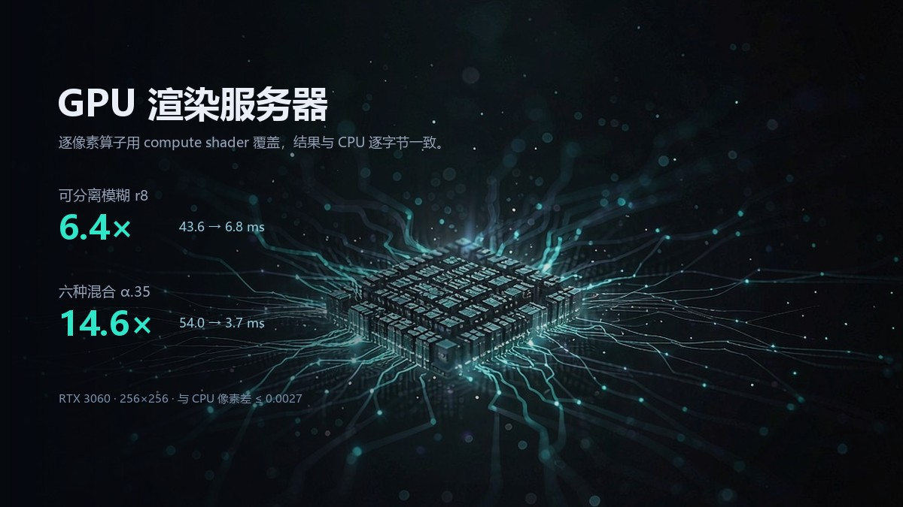
</div>

---

## Tests

14 headless suites covering the kernel, graph, editor, plugin lifecycle, pixel operators, text,
platform, IO, project files and architecture boundaries:

```bash
bash tools/run_tests.sh          # everything
godot --headless --path . --script res://tests/test_architecture.gd   # boundaries only
```

On-screen probes (real rendering / GPU / playback) live in `tests/_probe_*.gd`:

```bash
godot --path . --script res://tests/_probe_playback.gd    # playback acceptance (takes over the window)
godot --path . --script res://tests/_shot_release.gd      # regenerate docs/screenshots
```

> On-screen probes really load the 103-node project and play continuously; looking "frozen" is
> expected — it is doing the work.

---

## Documentation

- **[Plugin manual](docs/插件开发手册.md)** — writing a plugin from scratch: manifest fields,
  contribution points, contracts, pitfalls (Chinese).
- **[Architecture & implementation notes](docs/架构与实现.md)** — kernel boundaries, service
  brokers, frame cache format, every optimisation round with measurements (Chinese).
- **[Localisation guide](docs/本地化.md)** — UI language packs, adding a locale, keeping
  `README.en.md` in sync (Chinese).
- **[CONTRIBUTING.md](CONTRIBUTING.md)** — build, style, test requirements, PR flow.
- **[CLAUDE.md](CLAUDE.md)** — project conventions for AI collaborators (commands, invariants,
  traps).

---

## Related work & credits

This project stands on the following (**none of them is a runtime dependency except Godot**):

| Project                                                                                     | Relationship                                                                                      |
| ------------------------------------------------------------------------------------------- | ------------------------------------------------------------------------------------------------- |
| [A Programming Paradigm for Spatiotemporal Composability](https://arxiv.org/abs/2608.25512) | The core design paper. Plugin boundaries, brokers, space/time orthogonality and the reversible ledger all follow it |
| [Godot Engine](https://godotengine.org/)                                                    | The engine (4.7.2). Rendering, scene tree and `RenderingDevice` compute all come from it            |
| [patch-gg/pixelfx](https://github.com/patch-gg/pixelfx)                                     | Pixel asset and operator inspiration; `core.asset` bundles 244 packs                                |
| [Small-tailqwq/dsh-deep-whale](https://github.com/Small-tailqwq/dsh-deep-whale)             | Reference project for the skin manager idea                                                        |
| [maid-atelier](https://github.com/Small-tailqwq/dsh-deep-whale/tree/main/maid-atelier)      | Origin of the "Deep Sea Maid Atelier" theme skin                                                    |
| [skin-manager](https://github.com/Small-tailqwq/dsh-deep-whale/tree/main/skin-manager)      | Reference implementation for skin management                                                       |
| [DeepSeek Harness](https://www.deepseek.com/harness)                                        | AI toolchain used during development                                                               |
| [WorkBuddy](https://www.workbuddy.cn)                                                       | Build, test and documentation collaboration environment                                            |

Code is released under [MIT](LICENSE). Assets and fonts keep their original licences
(pixelfx is MIT; HarmonyOS Sans ships with its own licence; `skin.maid-atelier` is
**CC BY-NC-SA 4.0 — non-commercial**). See **[THIRD_PARTY_NOTICES.md](THIRD_PARTY_NOTICES.md)**.

---

<div align="center">
  <sub>Describe space with nodes, describe time with frames, let plugins do the rest.</sub>
</div>
