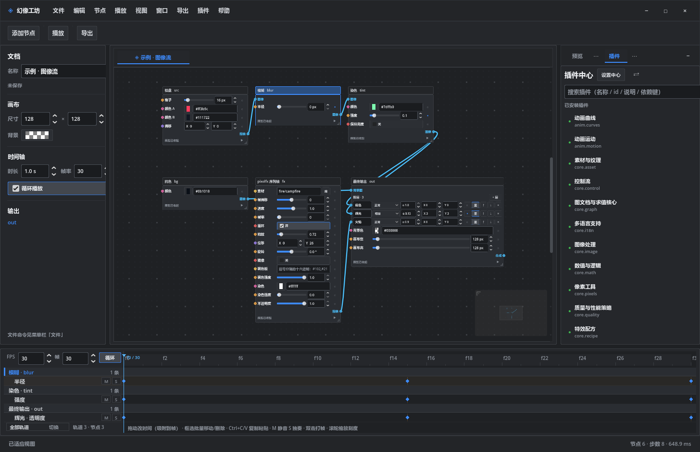
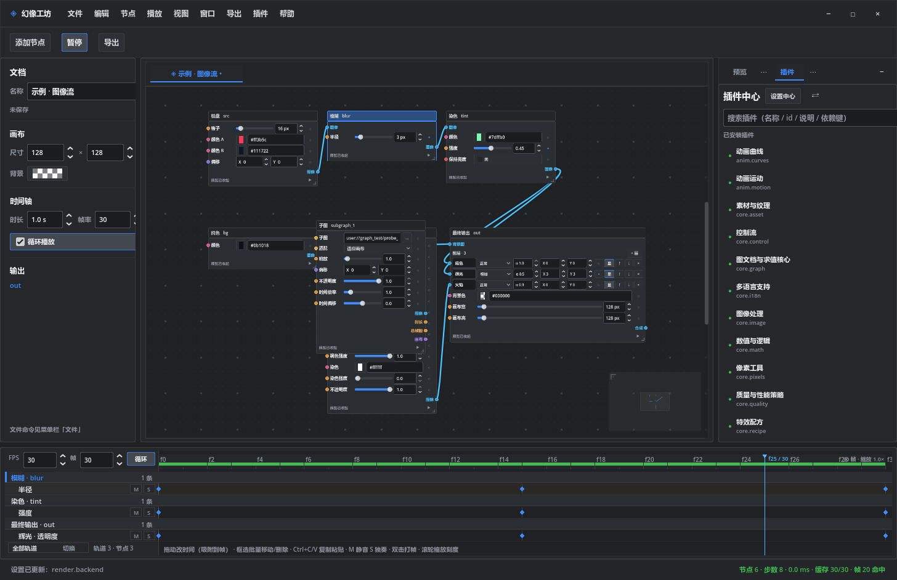
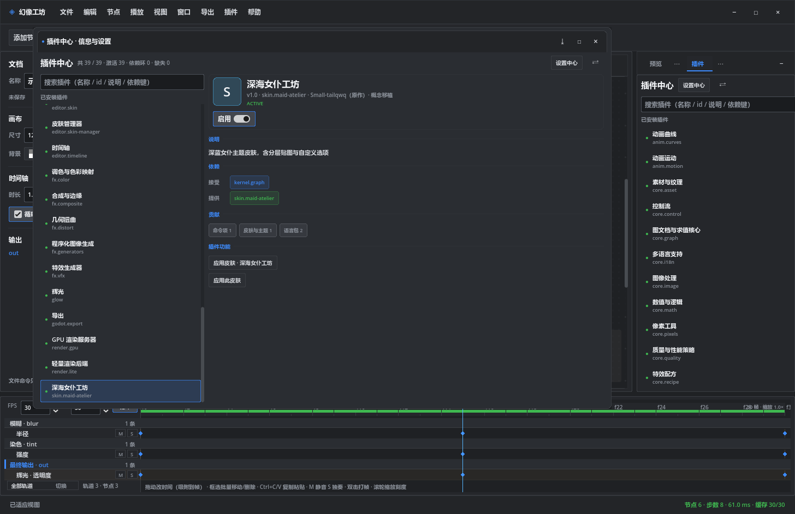
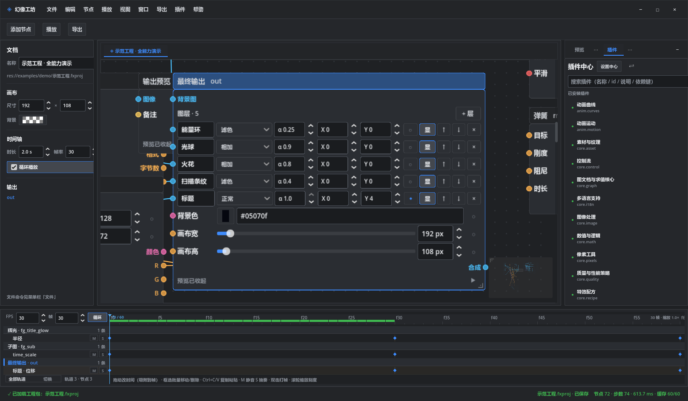
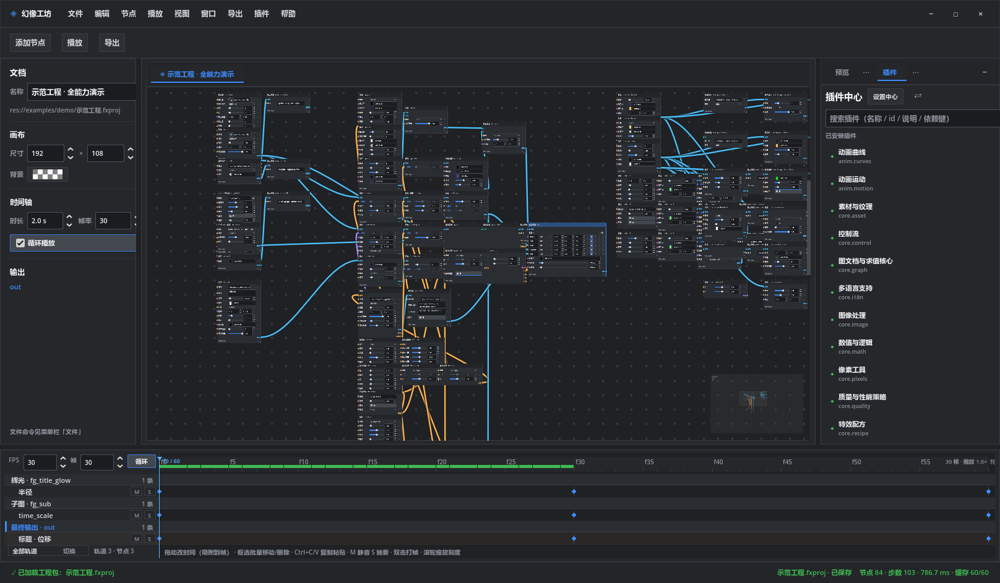
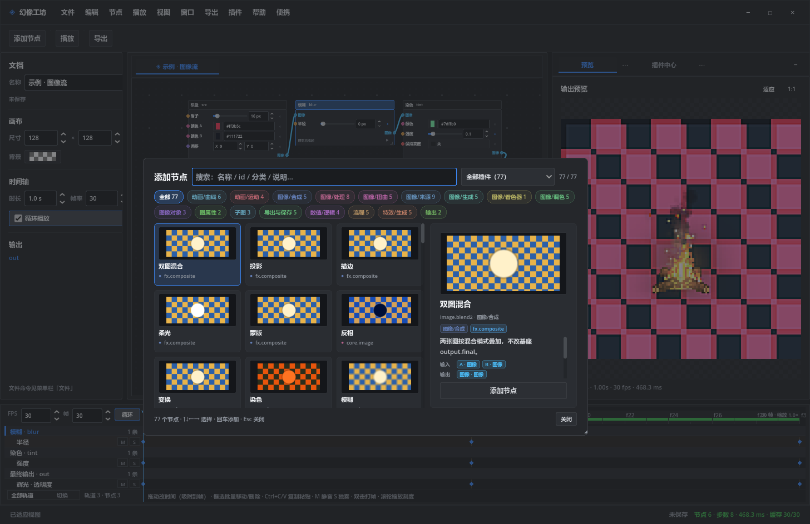
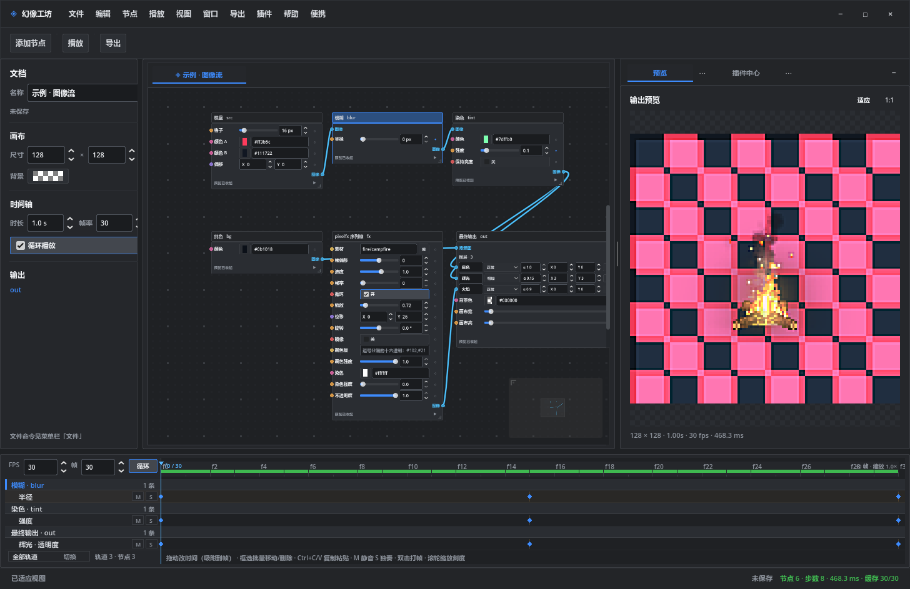
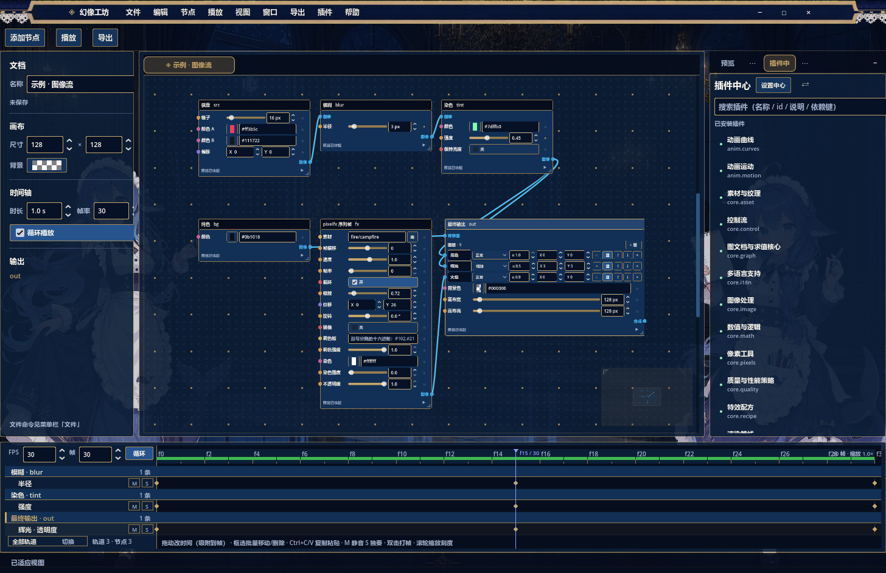
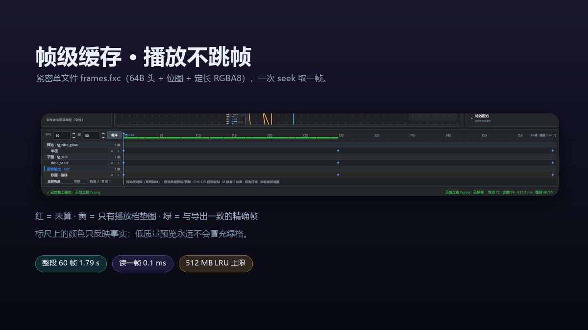
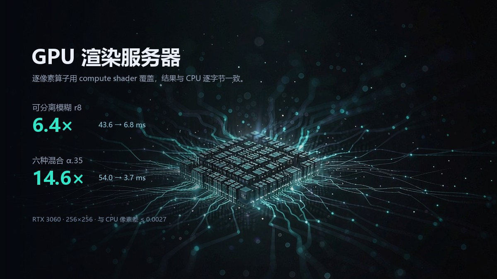

<div align="center">


# 幻像工坊 · Phantom Workshop

**微内核 + 一切皆插件化的节点式实时特效工坊**。


<sub>**简体中文** · [English](README.en.md)</sub>

[快速开始](#快速开始) · [截图](#界面) · [插件地图](#插件地图) · [架构](#架构) · [性能](#真实工程性能) · [参与贡献](CONTRIBUTING.md)

</div>

---

## 这是什么

幻像工坊是一个跑在 [Godot 4.7](https://godotengine.org/) 上的 **2D 特效合成器**：把节点连成图，  
图在时间轴上动起来，编辑器实时给你看结果，最后导出成视频或序列帧。

与众不同的地方不是「有节点」，而是**软件本身是可拆卸的**：

- 基座只有 **8.9k 行**：文档撤销栈、上下文/作用域、注册表与账本、服务代理、外壳与停靠。
- 其余全部是 **39 个插件**：图语义、求值器、渲染编排、GPU 后端、算子库、蓝图编辑器、  
  时间轴、皮肤、导出器、语言包……每个都能单独停用、热重载、或在运行时换掉。
- 基座源码里 **不出现任何插件类名**。删掉 `plugins/core.render/`，软件照样启动，  
  只是拿到一个「空呈现器」——没画面，但菜单、面板、快捷键都还在。

这不是工程洁癖。它来自一篇论文：

> **A Programming Paradigm for Spatiotemporal Composability**  
> <https://arxiv.org/abs/2608.25512>

论文的核心主张是 **空间与时间必须正交**：空间（图结构、子图、算子）与时间（时钟、帧号、  
缓存）各自独立演化，只在「组合点」相遇。本项目就是这条主张的一次完整落地：

| 维度 | 谁负责             | 具体表现                                      |
| -- | --------------- | ----------------------------------------- |
| 空间 | `core.graph`    | 文档、节点、端口、连线、子图。解释器不认识 UI，编辑器不认识图容器        |
| 时间 | `core.timeline` | `FxPlaybackClock` 只回答「该不该进下一帧」，不认识图、缓存、UI |
| 组合 | `core.render`   | 唯一同时持有「帧号」和「这一帧的图」的地方；播放时只读缓存，绝不求值        |

三者之间没有共享可变状态，只有 broker 契约。所以你可以把时钟换成变速/音频驱动，  
把后端换成 GPU，把编辑器换成别的形态，而不动另外两块。

---

## 界面

<div align="center">    
      
  <sub>左：文档与画布 · 中：蓝图（节点卡片上直接显示该节点这一帧的输出小图）· 右：预览与插件中心 · 下：时间轴</sub>    
</div>

<table>    
<tr>    
<td width="50%">    
   <sub><b>时间轴</b>：标尺按帧刻度，滚轮以光标为锚点缩放，色带逐帧显示缓存状态</sub></td>    
<td width="50%">    
   <sub><b>插件中心</b>：39 个插件的启用状态、依赖、提供的能力与设置项，一键启停</sub></td>    
</tr>    
<tr>    
<td>    
   <sub><b>节点卡片</b>：展开即实时预览，右上角状态签说明这一帧烘没烘好（✓ / … / —）</sub></td>    
<td>    
   <sub><b>示范工程</b>：103 节点 / 81 连线 / 192×108 / 30fps / 60 帧 —— 所有性能数字的唯一基准</sub></td>    
</tr>    
<tr>    
<td>    
   <sub><b>添加节点</b>：77 个节点按 11 个分类归档，卡片本身就是实时缩略图，右侧直接看端口与参数</sub></td>    
<td>    
   <sub><b>工作台</b>：节点参数内联编辑、标尺按帧对齐（f2 / f4 …）、标尺下方逐帧缓存色带</sub></td>    
</tr>    
</table>

<div align="center">    
      
  <sub>皮肤不是换配色：面板、停靠、节点卡片、端口都由插件重绘（皮肤包可以单独安装 / 停用）</sub>    
</div>

---

## 亮点

<table>    
<tr>    
<td width="33%" valign="top">

**可拆卸的插件体系**

节点类型、算子、导出格式、参数控件、面板、窗口、命令、菜单、皮肤、语言包、素材包，  
全部是贡献点。热重载按 LIFO 撤回，停用一个插件不会留下半截 UI。

</td>    
<td width="33%" valign="top">

**播放只读缓存**

帧被算过一次就落进紧密单文件 `frames.fxc`：64B 头 + 位图 + 定长 RGBA8。  
播放时一次 `seek` 取一帧（约 0.1 ms），**0 跳帧、0 未命中**，界面线程不做任何求值。

</td>    
<td width="33%" valign="top">

**GPU 渲染服务器**

逐像素算子用 compute shader 覆盖，结果与 CPU **逐字节一致**（像素差 ≤ 0.0027）。  
模糊快 6.4×，混合快 14.6×；无图形设备时自动退回 CPU，不停机。

</td>    
</tr>    
</table>

<div align="center">    
      
</div>

**颜色只说事实**：标尺上的红 = 没算过，黄 = 只有播放档垫图（画面能看，但不是精确帧），  
绿 = 与导出逐像素一致的精确帧。低质量预览永远不会冒充绿格——这是用户能一眼看懂的契约。

---

## 快速开始

### 直接下载（Windows 10/11 x64）

不想装 Godot 的话，抓现成的便携版：[**Releases · 最新版**](../../releases/latest)  
解压后双击 `幻像工坊.exe` 即可，无需安装、无需运行时；示例工程在
`examples/demo/示范工程.fxproj`。

### 从源码运行

**需要**：Godot **4.7.2**（标准版或 .NET 版均可，本项目是纯 GDScript）。

```bash
git clone https://github.com/QiNuoTu/phantom-workshop-Harness.git phantom-workshop
cd phantom-workshop

# 1) 打开工作台（编辑器形态）
godot --path .

# 2) 装配诊断：插件 / 节点 / 面板 / 设置 / 语言包 / 贴图 / 缓存位置
godot --headless --path . -- --fx-diagnose

# 3) 跑回归（14 套，约 4 分钟）
bash tools/run_tests.sh
```

**导出成 exe**：

```bash
godot --headless --path . --export-release "Windows Desktop" ../dist/幻像工坊.exe
```

打包脚本会把 `plugins/` 按插件 id 镜像到 exe 同级目录 —— 插件是**外部资源**，  
玩家可以直接删掉某个插件目录来精简功能。

### 目录结构

```
.
├── project.godot            # Godot 工程（仓库根目录就是工程根目录）
├── scenes/main.tscn         # 唯一场景：外壳 FxShell
├── scripts/graph/           # 基座（8.9k 行，不认识任何插件类名）
│   ├── kernel/              #   上下文 / 文档撤销栈 / 代理 / 注册表契约
│   ├── plugins/             #   插件宿主：扫描、依赖、可逆账本
│   ├── ui/                  #   外壳 / 停靠 / 窗口 / 皮肤 / 控件工厂
│   └── services/            #   资源根
├── plugins/                 # 39 个插件（每个都有 plugin.json + plugin.gd）
│   ├── core.graph/          #   图语义：文档、目录、端口、子图、求值器
│   ├── core.render/         #   渲染编排：时钟组合、帧缓存、预渲染
│   ├── render.gpu/          #   GPU 渲染服务器（compute shader）
│   ├── editor.*/            #   蓝图、时间轴、预览、皮肤、插件中心、设置…
│   └── fx.*/ glow/ …        #   算子库
├── examples/demo/           # 示范工程（性能基准，务必用它做验证）
├── docs/                    # 架构笔记 · 插件开发手册 · 截图
├── branding/         # 图标与宣传物料
├── tests/                   # 14 套回归 + 各种带显示的探针
└── tools/                   # 打包、图标渲染、素材生成
```

---

## 插件地图

启动日志里的 `39` 就是它们。按职责分成五层：

| 层           | 插件                                                                                                                                                                                                                                     | 贡献                                                   |
| ----------- | -------------------------------------------------------------------------------------------------------------------------------------------------------------------------------------------------------------------------------------- | ---------------------------------------------------- |
| **内核能力**    | `core.graph` `core.render` `core.timeline` `core.quality` `core.i18n` `core.asset` `core.pixels` `core.math` `core.text` `core.control` `core.shader` `core.recipe` `core.source` `core.image`                                         | 图语义、渲染编排、时钟、质量策略、语言、素材、像素工具、数学、文本、控件、着色器、配方、外部源、图像算子 |
| **求值后端**    | `render.gpu` `render.lite`                                                                                                                                                                                                             | compute 算子覆盖；播放时跳帧省预览的经济模式                           |
| **算子库**     | `fx.color` `fx.composite` `fx.distort` `fx.generators` `fx.vfx` `glow` `anim.curves` `anim.motion`                                                                                                                                     | 颜色、合成、扭曲、生成器、VFX、辉光、曲线、运动 —— 共 77 个节点/算子             |
| **编辑器**     | `editor.graph` `editor.timeline` `editor.preview` `editor.document` `editor.node-picker` `editor.palette` `editor.settings` `editor.plugins` `editor.plugin-hub` `editor.skin` `editor.skin-manager` `editor.help` `editor.dropimport` | 蓝图、时间轴、预览、文档标签、添加面板、命令面板、设置、插件管理、皮肤、帮助、拖拽导入          |
| **皮肤 / 导出** | `skin.maid-atelier` `godot.export`                                                                                                                                                                                                     | 第三套主题；PNG 序列 / GIF / 视频等 4 个导出器                      |

一个插件能贡献什么，全部写在 `plugin.gd` 的方法里：

```gdscript
nodes()          # 节点定义（nodes*.json）
ops()            # 算子实现（静态 Callable）
render_backends()# 求帧后端
exporters()      # 导出格式
panels()         # 面板
windows()        # 独立窗口
commands()       # 命令（菜单 / 命令面板 / 快捷键共用）
status_fragments() # 状态栏片段
settings()       # 设置项（含按钮型 action）
skins()          # 皮肤与停靠样式
locales()        # 语言包
quality_policies() # 质量策略 provider
graph_access()   # 图能力实现
node_picker()    # 添加面板的检索实现
drop_handlers()  # 拖拽导入
```

写一个新插件只需要两个文件：`plugin.json`（元数据 + 依赖 + 注入键）和 `plugin.gd`  
（继承 `FxPlugin`），细节见 **[插件开发手册](docs/插件开发手册.md)**。

---

## 架构

```mermaid
flowchart TB
  subgraph Base["基座 scripts/graph（8.9k 行，零插件类名）"]
    direction LR
    B1[FxContext / Fiber / Scope]
    B2[FxDocumentStore<br/>撤销栈 + 内容身份]
    B3[FxRegistry / FxPluginHost<br/>可逆账本]
    B4[FxGraphFacade / FxRenderBroker<br/>FxClockBroker / FxSettings …]
    B5[FxShell<br/>停靠 / 窗口 / 皮肤 / 菜单]
  end

  subgraph Domain["插件（可插拔）"]
    D1[core.graph<br/>图语义 + 求值器]
    D2[core.timeline<br/>FxPlaybackClock]
    D3[core.render<br/>渲染编排 + 帧缓存]
    D4[render.gpu<br/>compute 算子]
    D5[editor.*<br/>蓝图 / 时间轴 / 预览]
  end

  B4 -->|doc_* 契约| D1
  D3 -->|只问「进不进下一帧」| D2
  D3 -->|取图| D1
  D3 -->|postprocess| D4
  D5 -->|只 inject graph.facade| B4
  B5 -->|services["render"]| D3
```

三条硬规则（`tests/test_architecture.gd` 静态断言盯着）：

1. **基座不出现插件类名** —— 不是「停用后不崩」，而是「删掉目录仍能编译」。
2. **界面不出现图领域符号** —— 编辑器只 inject `graph.facade`，不 import 任何容器类。
3. **节点类型只活在插件里** —— 执行器与 UI 里没有 `if type == "image.blur"`，只有 op 表。

### 时空可组合的落点

- 文档写入只走 `FxDocumentStore.mutate / apply_param / apply_path`；批量用 `begin_batch/commit_batch`。  
  写前写后相同就**完全静默**：不记撤销点、不递增修订号、不广播。
- 「内容身份」`content_key = 世代 × 2²⁰ + 修订号`：换工程、改参数会变，但拖节点（纯布局）不会。  
  渲染端据此决定缓存桶与快照是否重做 —— 一次拖拽不该让整段 60 帧缓存作废。
- 播放帧号每个 process 至多 `+1`：界面掉帧时播放变慢，但绝不跳号；目标帧连垫图都没有才挂起等。

---

## 真实工程性能

> **唯一基准**：`examples/demo/示范工程.fxproj` —— 103 节点 / 81 连线 / 192×108 / 30fps / 60 帧。  
> 所有数字都在同一台机器（RTX 3060 / 12 核）上用带显示的探针实测，脚本在 `tests/`。

| 指标               | 数值                                               |
| ---------------- | ------------------------------------------------ |
| 单帧求值（CPU 逐像素）    | **480 – 530 ms**（优化前 643 ms）                     |
| 整段 60 帧并行预渲染     | **1.79 s**（6 线程；单线程约 36 s）                       |
| 播放 73 帧          | **0 跳帧 · 0 未命中**，界面帧时间 **13.3 ms**（空闲基线 13.2 ms） |
| 打开工程 → 预渲染启动     | **31 – 80 ms**                                   |
| GPU 算子：可分离模糊 r8  | 43.6 → **6.8 ms**（**6.4×**）                      |
| GPU 算子：六种混合 α.35 | 54.0 → **3.7 ms**（**14.6×**）                     |
| GPU 与 CPU 像素差    | **≤ 0.0027**（逐字节比对）                              |
| 缓存读取             | **0.1 ms/帧**（PNG 编码曾是 11 ms/帧）                   |

<div align="center">    
      
</div>

---

## 测试

14 套无头回归，覆盖基座、图、编辑器、插件生命周期、像素算子、文本、平台、IO、工程文件与架构边界：

```bash
bash tools/run_tests.sh          # 全量
godot --headless --path . --script res://tests/test_architecture.gd   # 只跑架构边界
```

带显示的探针（真实渲染 / GPU / 播放）在 `tests/_probe_*.gd`，例如：

```bash
godot --path . --script res://tests/_probe_playback.gd    # 播放不跳帧验收（会占用窗口）
godot --path . --script res://tests/_shot_release.gd      # 重新生成 docs/screenshots
```

> 带显示的探针会真的加载 103 节点工程并连续播放，看起来像「卡住」是正常的 —— 它就是在跑。

---

## 文档


- **[插件开发手册](docs/插件开发手册.md)** —— 从零写一个插件：清单字段、贡献点、契约、常见坑。
- **[架构与实现笔记](docs/架构与实现.md)** —— 微内核边界、服务代理、帧缓存格式、每一轮性能优化的实测与踩坑。
- **[本地化与翻译](docs/本地化.md)** —— 界面语言包怎么加、回退链与合并顺序、`README.en.md` 同步规则与术语表。
- **[CONTRIBUTING.md](CONTRIBUTING.md)** —— 构建、代码风格、测试要求、PR 流程。
- **[CLAUDE.md](CLAUDE.md)** —— 给 AI 协作者的项目约定（命令、不变量、陷阱）。

---

## 相关项目与致谢

本项目站在这些工作之上（**除 Godot 引擎外都不是运行时依赖**）：

| 项目                                                                                          | 关系                                              |
| ------------------------------------------------------------------------------------------- | ----------------------------------------------- |
| [A Programming Paradigm for Spatiotemporal Composability](https://arxiv.org/abs/2608.25512) | 核心开发理念论文。插件边界、broker、时空正交、可逆账本都按它落地             |
| [Godot Engine](https://godotengine.org/)                                                    | 引擎（4.7.2）。渲染、场景树、`RenderingDevice` compute 都来自它 |
| [patch-gg/pixelfx](https://github.com/patch-gg/pixelfx)                                     | 像素素材与算子灵感来源；`core.asset` 收录了 244 套素材            |
| [Small-tailqwq/dsh-deep-whale](https://github.com/Small-tailqwq/dsh-deep-whale)             | 皮肤管理器的思路参照项目。                                   |
| [maid-atelier](https://github.com/Small-tailqwq/dsh-deep-whale/tree/main/maid-atelier)      | 「深海女仆工坊」主题皮肤的出处                                 |
| [skin-manager](https://github.com/Small-tailqwq/dsh-deep-whale/tree/main/skin-manager)      | 皮肤管理器的参考实现                                      |
| [DeepSeek Harness](https://www.deepseek.com/harness)                                        | 开发期使用的 AI 工具链                                   |
| [WorkBuddy](https://www.workbuddy.cn)                                                       | 构建、测试与文档协作环境                                    |

代码以 [MIT](LICENSE) 发布；素材与字体各自遵循原许可（pixelfx 为 MIT、HarmonyOS Sans
需随附许可、`skin.maid-atelier` 为 **CC BY-NC-SA 4.0 禁止商用**），
详见 **[THIRD_PARTY_NOTICES.md](THIRD_PARTY_NOTICES.md)**。

---

<div align="center">  
  <sub>用节点描述空间，用帧描述时间，剩下的交给插件。</sub>  
</div>
