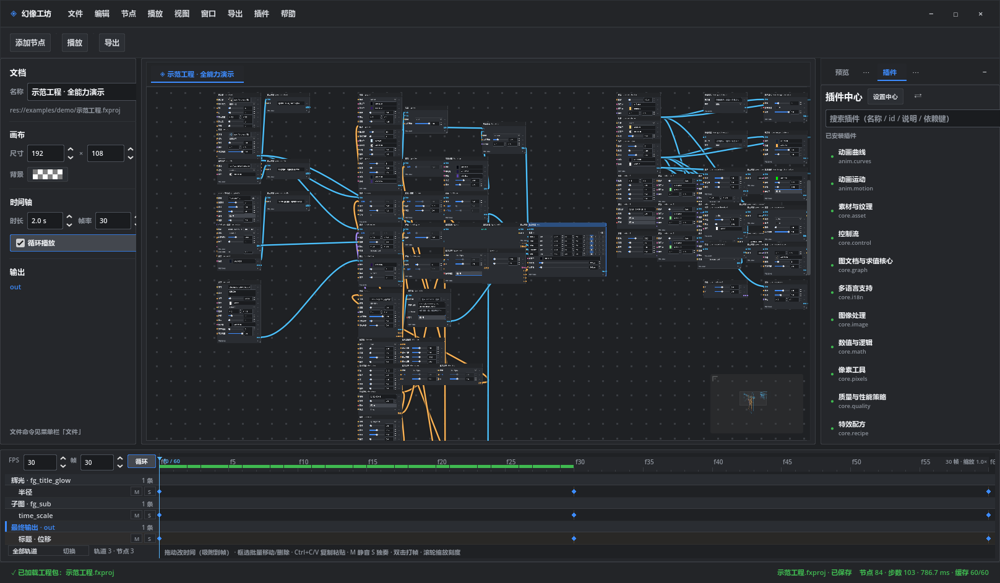
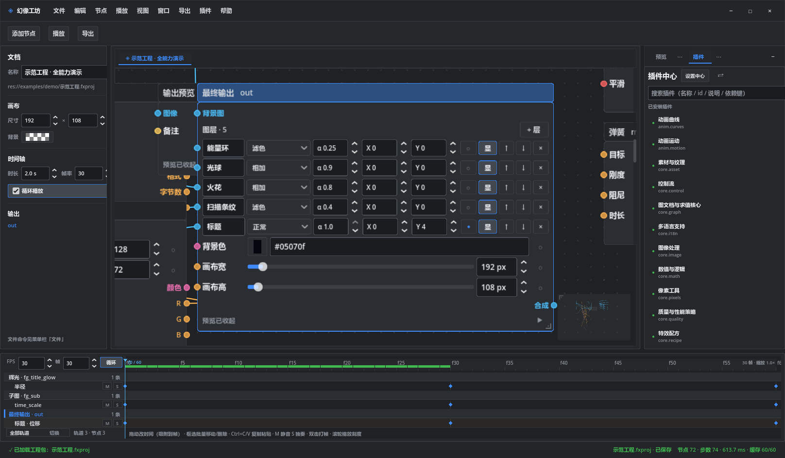
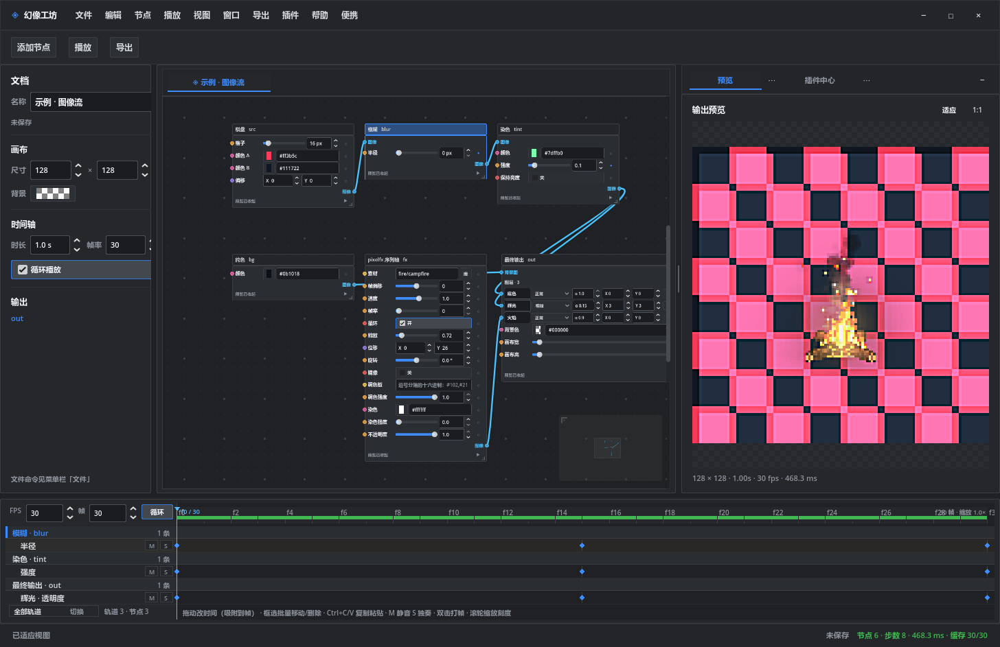
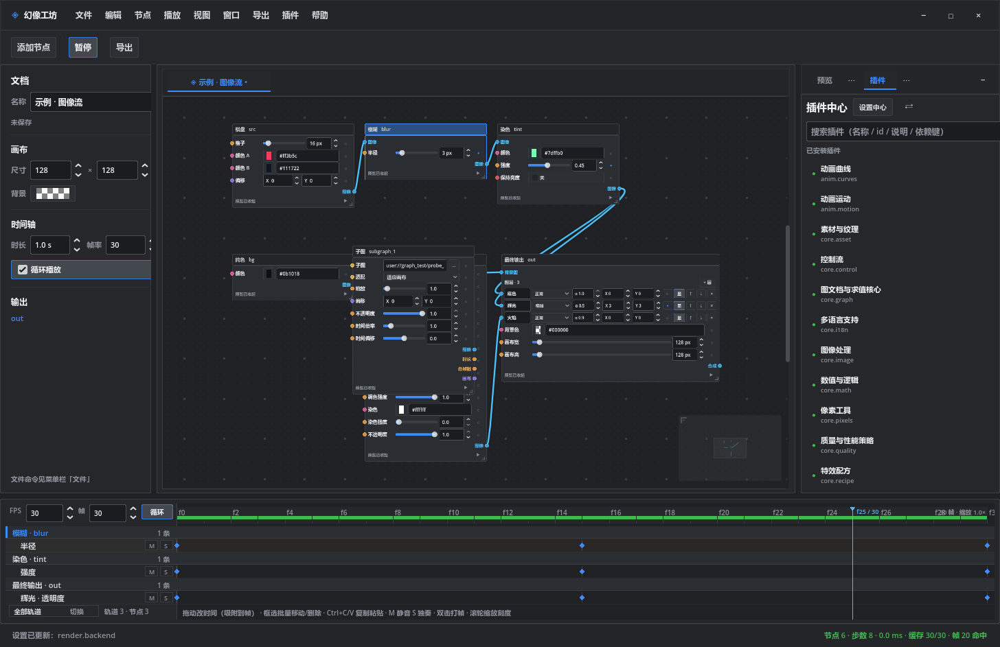
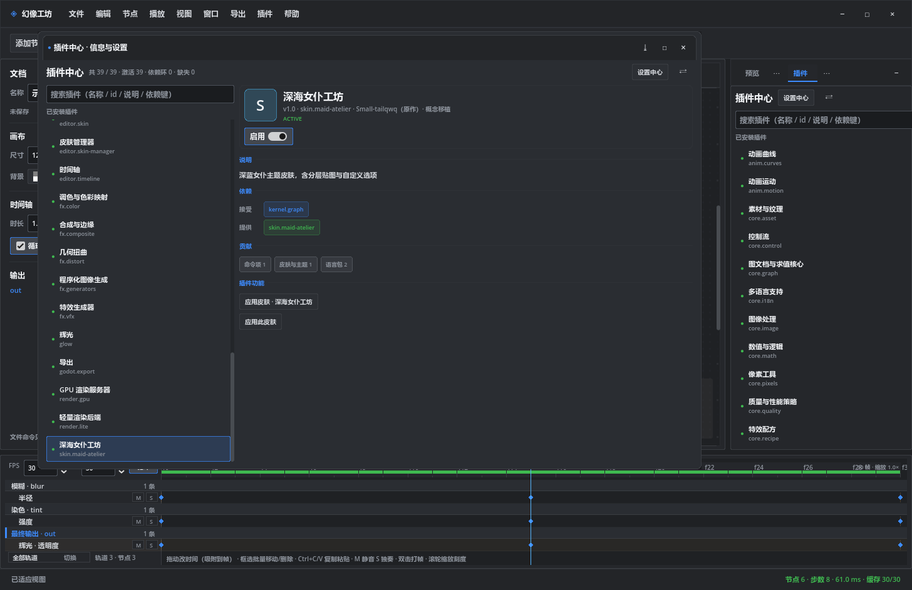
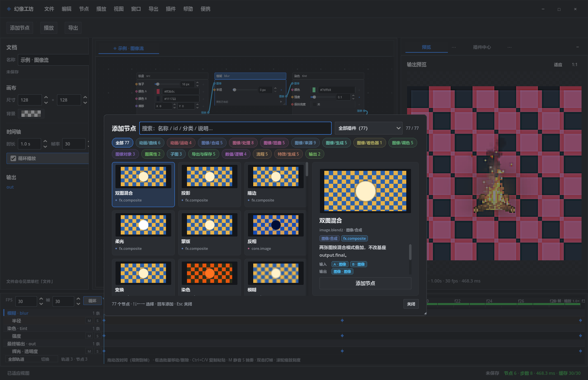
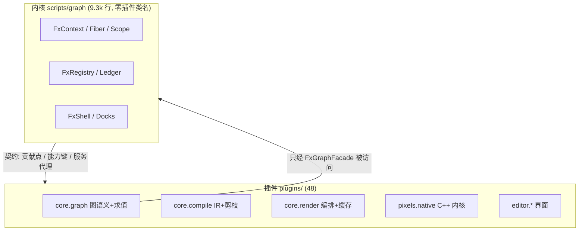

<div align="center">


# 幻像工坊 · Phantom Workshop

**微内核 + 一切皆插件化的节点式 2D 特效工坊**


<sub>**简体中文** · [English](README.en.md)</sub>

</div>

> **当前状态 `0.0.20-alpha`（最初测试版）。** 远未达到生产可用：接口、文件格式、
> 性能都可能变。仓库没有正式构建，请从源码运行——它自己就是编辑器。
> GitHub 上的 Release **一律标记为 Pre-release**，不产生「最新稳定版」。
>
> 这一版做的是**把话说准**：所有数字都由 `python tools/check_docs.py` 从代码里取，
> 文档里对不上就返回非 0；六项待办的真实进度写在 [已知缺口](#已知缺口)。
> 代码与文档不一致时，以脚本输出为准。

## 它是什么

一个跑在 Godot 4.7 上的 **2D 特效合成器**：节点连成图，图在时间轴上动起来，
编辑器实时给你看结果，最后导出视频或序列帧。

与众不同的不是「有节点」，而是**软件本身可拆卸**：

| 层 | 位置 | 体量 | 职责 |
| --- | --- | --- | --- |
| **内核** | `scripts/graph/` | 9.3k 行 | 上下文与作用域、组件/纤维生命周期、注册表与账本、设置、服务代理、外壳与停靠 |
| **插件** | `plugins/` | 31k 行 / 42 个 | 图语义、求值器、IR 编译、渲染编排、GPU 后端、原生像素内核、算子库、蓝图编辑器、时间轴、皮肤、导出器、语言包、诊断 |

内核里**不出现任何插件类名**——`--fx-run=diag.blame` 会自报这条事实（当前：内核 0 条）。
删掉 `plugins/core.render/` 仍能启动，只是拿到一个空呈现器：没画面，菜单与面板都在。

## 范式：照它组织边界，不是等价实现

设计参照 *[A Programming Paradigm for Spatiotemporal Composability](https://arxiv.org/abs/2608.25512)*：
**空间**（依赖声明与响应）与**时间**（副作用的可撤回）各自独立演进，只在组合点相遇。

**已在代码里成立的**（每条都能指到文件）：

| 论文 | 落点 |
| --- | --- |
| 余效果上下文 Σ（键 → 值 / 键 → 提供者） | `FxContext.values` / `providers` |
| 依赖满足判定 `σ ⊧ d` | `FxContext.satisfies()` |
| 通知三分类（activating / deactivating / neutral） | `FxFiber.refresh()` |
| 带见证的效果与逆操作栈（LIFO） | `FxEffectScope.add(inverse)` |
| 组件 =(d, p, e)、纤维含 retire | `FxComponent` / `FxFiber` |
| 声明式装载 + 配置调和 + 热重载 | `FxPluginHost` / `plugins.cfg` |

**明确没做到的**（写在这里，免得有人按论文的强保证来用）：

1. **没有值等价关系 `≃ₖ`**。`set_value()` / `provide()` 写进去就通知，不比新旧值。
   后果是通知偏多、下游重建偏多——这是「缓存重建」问题的语义根源之一。
2. **`set` 没有「键未被占用」的前置条件**，实为后登记者覆盖（`render.gpu` 覆盖
   `image.blur` 就是靠这个）。于是「同一 registry 内供给互斥」这条保证不成立。
3. **没有 isolation / interception / 派生上下文**。上下文是一张平表，
   无法给两个组件绑定同一键的不同值，也无法在依赖访问路径上插横切逻辑。
4. **时间可组合只在 UI/服务层成立**。图与算子层的卸载靠
   `reset_runtime_tables()` 整体清表兜底，不是「逆操作恰好恢复原状」。

一句话：**范式是组织边界的依据，不是已经兑现的数学保证。**

## 快速开始

```bash
git clone https://github.com/QiNuoTu/phantom-workshop-Harness.git
cd phantom-workshop-Harness
godot --path .                     # 直接启动工作台（主场景 scenes/main.tscn）
```

没有可下载的正式构建。原生像素内核是**可选加速层**，没编也能跑（全部回落 GDScript，只是慢）：

```bash
# 需要 godot-cpp 源码 + MSVC。不编也不影响功能，只影响速度。
bash plugins/pixels.native/build.sh template_debug
```

调色抠像套装（`fx.keying` / `fx.channels` / `fx.masks` / `fx.tone` / `fx.stylize`，
29 个算子）**没有回落**：算子只存在于 `plugins/fx.native-kit` 的 C++ 里。
不编这一步，这五个插件不会激活、它们的节点也不会出现（`diag.blame` 会直接指出原因）：

```bash
bash plugins/fx.native-kit/build.sh template_debug
```

回归与自检：

```bash
bash tools/run_tests.sh            # 25 套 / 1693 条断言（0 失败、0 异常退出，含算子预算门禁）
python tools/check_docs.py         # 文档与代码一致性（CI 用，非 0 表示不一致）
```

## 界面

<table>
  <tr>
    <td></td>
    <td></td>
  </tr>
  <tr>
    <td align="center"><sub><b>工作台</b>：左侧节点库、中间蓝图、右侧参数、底部时间轴</sub></td>
    <td align="center"><sub><b>节点卡片</b>：端口类型、参数、本帧输出读数（数值带曲线采样）</sub></td>
  </tr>
  <tr>
    <td></td>
    <td></td>
  </tr>
  <tr>
    <td align="center"><sub><b>缓存带</b>：绿=精确帧已缓存，橘=正在渲染，黄=垫图待替换</sub></td>
    <td align="center"><sub><b>播放</b>：播放头推进只读缓存，缺帧才挂起</sub></td>
  </tr>
</table>

<table>
  <tr>
    <td></td>
    <td></td>
  </tr>
  <tr>
    <td align="center"><sub><b>插件中心</b>：48 个插件的依赖、能力、设置项与启停</sub></td>
    <td align="center"><sub><b>添加节点</b>：106 个节点按 22 类归档，卡片本身是实时样张</sub></td>
  </tr>
</table>

## 插件地图

| 分组 | 插件 | 提供什么 |
| --- | --- | --- |
| **内核能力** | `core.graph` `core.compile` `core.render` `core.quality` `core.timeline` `core.control` `core.i18n` | 图语义与求值器、IR 编译与剪枝、渲染编排与帧缓存、质量策略、时钟、配色、语言包 |
| **像素** | `core.pixels` `core.image` `core.source` `core.text` `core.asset` `core.recipe` `core.shader` | 混合/重采样工具、图像算子、生成器、文本栅格化、pixelfx 素材、配方引擎、着色器节点 |
| **加速** | **`pixels.native`** **`fx.native-kit`** `render.gpu` `render.lite` | 两份 GDExtension：前者是五个有回落的全工程像素族，后者是调色抠像套装 28 个算子的**唯一实现**；GPU compute 后端、纯 CPU 后端 |
| **算子库** | `core.math` `fx.color` `fx.composite` `fx.distort` `fx.generators` `fx.vfx` `glow` `anim.curves` `anim.motion` `fx.keying` `fx.channels` `fx.masks` `fx.tone` `fx.stylize` | 数值与逻辑、颜色、合成、扭曲、生成器、VFX、辉光、曲线、运动、抠像、通道、蒙版、色调、风格化 —— 106 个节点整体在这个范围里 |
| **编辑器** | `editor.document` `editor.graph` `editor.preview` `editor.timeline` `editor.node-picker` `editor.palette` `editor.plugin-hub` `editor.plugins` `editor.settings` `editor.skin` `editor.skin-manager` `editor.help` `editor.dropimport` `editor.diagnostics` | 文档与撤销栈、蓝图视图、输出预览、时间轴、节点面板、调色板、插件中心、设置、皮肤、帮助、拖拽导入、归因诊断 |
| **外观 / 输出** | `skin.maid-atelier` `godot.export` | 皮肤、导出器（视频 / 序列帧 / PNG） |

插件用 JSON 声明、用 `FxPlugin` 子类贡献能力。写一个是**加目录**，不是改外壳——
见 [插件开发](docs/插件开发.md)。

## 架构



三条硬纪律（都有机器检查，不靠自觉）：

1. **内核源码零插件类名**——`test_architecture` 白名单 + `diag.blame` 结构扫描。
2. **图语义只在 `core.graph`**，基座只经 `FxGraphFacade.access()`；节点类型只在
   `nodes*.json` + 算子表，不在代码里写死。
3. **呈现器是契约不是实现**——`FxRenderHost` 是空实现，`core.render` 继承它；
   外观 id 不写死，默认取 order 最小的。

细节见 [架构](docs/架构.md)。

## 缓存、预览与剪枝

**帧缓存**是这软件的核心资产：一帧算对了就存盘（`frames.fxc`，64B 头 + 定长 RGBA8），
播放只读缓存。

- **定桶依据是内容身份**，不是「通知」：`content_key() = 世代×2²⁰ + 内容修订`。
  拖动节点、缩放分组、改选中**不算内容**，不换桶、不重画。
- **失效分三档**：`content`（换桶）/ `derived`（丢派生表与样张，保留精确帧）/
  `display`（只丢显示层）。设置项用 `impact` 声明自己属于哪一档（26 个 runtime 项已标注）。
- **预览有两条管线**：节点小图可降算子质量（默认 0.5）、输出预览恒精确。
  精确性由「算它的那一档质量」决定，结果自带 `frame_quality`，不看「此刻在不在播」。
- **动态质量**：内容一变，整段先用 **1/8 画布**铺一遍垫图（黄格，60 帧约 3 帧内完成），
  精确帧随后逐格替换成绿色；当前帧另有一条单帧草稿线（1/8 → 1/4 → 1/2）负责
  「停下来改参数」的那一眼。草稿只服务显示：写进垫图层（不落盘、不归档）、不跑汇点、
  不进显示缓存，所以「改完立刻有画面」与「导出逐像素不变」不冲突。
  成本与播放收益见 [性能口径](docs/性能口径.md) §3.1–3.2。
- **停靠区默认面板由 `order` 决定**（可见面板里最小的那个），不由装配顺序决定 ——
  右侧区打开软件就是「预览」，不是插件列表。
- **标尺四色**：红=没算过 · **橘=正在渲染** · 黄=只有垫图 · 绿=精确帧已缓存。
  橘色是调度事实（此刻谁在算这一格），不是缓存状态 —— `cache.state()` 永远不返回它。
- **画布尺寸只有一个来源**（`meta.canvas`）：帧缓存是定长紧密文件，帧尺寸就是它的布局，
  所以「文档说 192、节点说 256」这种状态一旦出现，每一帧都会被尺寸闸门丢掉。
  输出节点上那对宽/高滑块是画布的**视图**（声明 `binds`），改它等于改文档画布；
  定桶 / 出入库 / 上屏三道防线各自独立地拒绝异形帧。见 [架构](docs/架构.md) §5.1。
- **剪枝分两层**：拉取式求值天然不碰不可达节点；`core.compile` 再把图编译成
  纯数据计划（拓扑序 / live / dead / 汇点 / 常量 / 类型错误 / 帧段），
  求值器按计划跑。示范工程实测 **Live 85 / Dead 18**、常量折叠 2。

> 注意口径：Dead 18 是**结构剪枝上界**，不是提速。拉取式本来就跳过 Dead，
> 真实收益是「常量折叠让 steps 3→2」「汇点从 O(N) 变 O(汇点数)」与可观测性。

## 性能

口径固定：**`examples/demo/示范工程.fxproj`，103 节点，192×108，60 帧，无头**。
换口径的数字不予比较。

| 项 | 数值 | 说明 |
| --- | --- | --- |
| 整帧 | **69.0 ms** | 2026-11-17 实测，`tests/_profile_frame.gd` |
| 算子累计 | 44.1 ms（64%） | 97 次调用，平均 0.45 ms/次 |
| 框架/其它 | 24.9 ms（36%） | 端口表、参数解析、子图 runner、预览捕获 |
| 单帧最贵 | `graph.subgraph` 13.3 ms | 2 次调用，其中 3.55 ms 是子图内部算子 |

历史基线：纯 GDScript 逐像素 555 ms → 行内并行 344 ms（1.61×）→ 原生内核 226 ms（2.46×）
→ 当前 69 ms（相对最初 **8.0×**）。

两条可选加速路径，都可缺席：

- **原生像素内核**（`pixels.native`，GDExtension）：5 个类 / 25 个通用图元，
  不认识任何节点类型。缺席或停用即回落 GDScript，`tests/test_pixel_native.gd`
  用「开关两跑逐字节比对」守住精度（97 条断言）。
- **GPU compute**（`render.gpu`）：模糊、混合、锐化、描边；工作线程走
  `RenderingServer.call_on_render_thread` 合流。**主求值仍是 CPU**。

逐层分辨率档（`res_scale`）是唯一两位数百分比级别的开关：0.5 档 2.40×、0.25 档 3.59×（192²）。

## 诊断：先弄清「谁的错」

出问题时第一步不是改代码，是**归因**：

```bash
GODOT="D:/SteamLibrary/steamapps/common/Godot Engine/godot.windows.opt.tools.64.exe"

"$GODOT" --headless --path . -- --fx-diagnose                        # 有什么
"$GODOT" --headless --path . -- --fx-diagnose --fx-run=diag.blame    # 谁的错
"$GODOT" --headless --path . -- --fx-diagnose --fx-run=diag.cache    # 谁在重建
"$GODOT" --headless --path . -- --fx-diagnose --fx-run=diag.compile  # 图编译成什么
```

`diag.blame` 的结论有一行「需要动手：内核 N / 插件 M / 装配 K」，那是唯一行动依据。
归属来自**声明**而不是措辞：`FxBoot.error(where, msg, scope)` 的 `scope` 可以是
`kernel` / `assembly` / `plugin:<id>`，没声明才回落到文本推断——
上一版就是因为靠措辞猜，把「插件目录缺清单」判成了内核问题。

详见 [诊断与归因](docs/诊断与归因.md)。

## 已知缺口

六项待办的真实进度（不写「已完成」，写做了什么、没做什么）：

| # | 目标 | 现在 |
| --- | --- | --- |
| 1 | 只有数据改变才重建 | **主干完成**。三道闸门 + 每节点签名 + 下游闭包差量失效：改一个参数只废它和下游，上游缓存继续命中（`tests/test_invalidation.gd`）。 |
| 2 | 预览走独立可调质量管线 | **部分**。`display_scale`（1.0/0.5/0.25）只缩屏幕那一张，归档与导出逐像素不变；**草稿帧阶梯**（1/8 → 1/4 → 1/2）让「帧没算好也有画面」成立；节点小图仍走「全分辨率算完再 resize」。 |
| 3 | 运行时剪枝 | **部分**。IR 计划已接入三条求值路径（同步 / 工作线程 / 预渲染）；执行流入口、`evaluate_always` 旁支、无关键帧判定、端口表每帧重建仍未收口。 |
| 4 | 管线完全 GDExtension | **未做**。原生只覆盖 25 个图元；求值主循环、参数解析、端口转换、Image 分配仍在 GDScript（就是那 36%）。 |
| 5 | GDExtension 做成插件 | **已完成**。`plugins/pixels.native/` 是真插件：自带库与描述文件、声明能力、停用即回落；装配诊断会报「5/5 族在场」。 |
| 6 | 单体 CPP 打散 | **已完成**。1635 行单体 → 5 个算子族（point / warp / blend / edge / gen）+ `common/`，共 2027 行，逐字节对拍 97 条全过。 |

## 文档地图

| 想了解 | 看这里 |
| --- | --- |
| 代码里现在成立什么、边界怎么划 | [架构](docs/架构.md) |
| 写一个插件（清单、贡献点、贡献纪律） | [插件开发](docs/插件开发.md) |
| 抠像/通道/蒙版/色调分离/风格化这套节点怎么用 | [调色抠像套装](docs/调色抠像套装.md) |
| 四套版本号各管什么、什么时候涨 | [版本策略](docs/版本策略.md) |
| 性能数字怎么量、口径是什么 | [性能口径](docs/性能口径.md) |
| 出问题先判「谁的错」（装配 / 某个工程） | [诊断与归因](docs/诊断与归因.md) |
| 现在到哪一步、下一步做什么 | [路线与缺口](docs/路线与缺口.md) |
| 给 AI 协作者的约定（不变量清单） | [CLAUDE.md](CLAUDE.md) |

## 项目结构

```
phantom-workshop/
├── scripts/graph/           # 内核（9.3k 行，零插件类名，由 diag.blame 检查）
│   ├── kernel/              # 上下文、纤维、作用域、注册表、设置、启动
│   ├── plugins/             # 插件宿主与契约
│   ├── services/            # 文档存储、时钟代理、渲染代理
│   └── ui/                  # 外壳、停靠、皮肤、UI 组件
├── plugins/                 # 48 个插件（每个都有 plugin.json；pixels.native 另有 C++ 源码）
├── scenes/main.tscn         # 主场景
├── tests/                   # 25 套无头回归 + 带显示的探针
├── tools/                   # 回归脚本、文档一致性检查、图标与美术脚本
├── docs/                    # 架构、插件开发、诊断、版本策略、性能口径、路线与缺口、调色抠像套装
└── examples/demo/           # 示范工程（性能口径唯一来源）
```

## 参与贡献

见 [CONTRIBUTING.md](CONTRIBUTING.md)。两条最容易踩的：

- 改 `class_name` 之后必须 `--headless --editor --quit` 重建全局类缓存；
- 提交前 `bash tools/run_tests.sh` 与 `python tools/check_docs.py` 都要过。

## 许可证

MIT。第三方素材与字体见 [THIRD_PARTY_NOTICES.md](THIRD_PARTY_NOTICES.md)。
