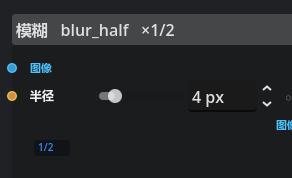

# 按 AE 类特效逻辑开发：对照清单

> 目的：把「逻辑要按照 AE 类特效逻辑开发」这句话变成**可核对**的条目。
> 每条写清「AE 里是什么 / 我们落在哪个文件 / 现在有没有 / 差在哪 / 验收方式」。
> 没有这一份，「像 AE」就只能靠感觉，最后写出来的说明又会和代码对不上。
>
> 当前版本：`app 0.0.9-alpha` / `kernel 0.1.2`（2026-11-15）

## 0. 先定一个前提：DAG 不是「偏离 AE」，而是它的超集

AE 的结构是 **图层 × 有序效果栈**：一个图层的像素依次流经效果 1、2、3。
这是**一条链**。本项目是 **DAG**：任何节点的输出可以被多处使用，也可以有分支。

- 链能做的事，DAG 都能做（把链画成节点连线即可）；
- DAG 能做的事，链做不了（一个模糊结果同时喂两个混合、旁支对比、共用预合成）。

所以策略不是「改成效果栈」，而是：**数据模型保留 DAG，交互与语义按 AE 的心智对齐**——
用户看到的是「图层 + 效果 + 关键帧」，底下是 DAG。这条是后面所有取舍的依据。

## 1. 对照表

| AE 概念 | 本项目落点 | 现状 | 差距 / 下一步 |
| --- | --- | --- | --- |
| 合成（Comp）：画布 + 帧率 + 时长 | 文档 `meta.canvas` / `meta.timeline` | ✅ 已有 | 合成没有「多个合成并存」的概念，只能靠子图/标签页，命名与层级偏弱 |
| 图层（Layer）：素材 / 纯色 / 预合成 | `output.final` 的 `layers` 参数（`core.image/nodes_output.json`） | ✅ 已有 | 图层类型现在靠上游节点决定，没有「图层类型」这一栏；入点/出点（trim）未做 |
| 图层顺序 = 合成顺序 | `layers` 数组顺序（`layer_<id>` 动态端口） | ✅ 已有 | 顺序语义（谁在上）未在界面上明示，靠连线视觉暗示 |
| 混合模式 | 6 种（`fx.composite` 的 `mode`） | ✅ 已有 | 缺 AE 的「模板 Alpha / 亮度遮罩」类模式 |
| 效果（Effect）= 挂在图层上的有序栈 | 节点链（DAG 的一条路径） | ⚠️ 部分 | **没有「效果栈」这一层视图**：用户看到的是节点图，不是「这个图层挂了 3 个效果」 |
| 效果参数 + 关键帧 | 节点 `params` + `FxTracks`（`ease`/`step`） | ✅ 已有 | 插值类型比 AE 少（无贝塞尔手柄编辑） |
| 预合成（Pre-compose） | `graph.subgraph` 节点 + `.fxgraph` 文件（打包/解包） | ✅ 已有 | 子图参数（`path`/`fit`）够用；缺「进入子图后改合成设置」 |
| 调整层（Adjustment Layer） | 无 | ❌ 缺 | 效果影响其下所有层。可先用「把下面几层合成后再处理」表达，但不是同一个心智 |
| 表达式（Expression） | 无（有数值/曲线节点可替代一部分） | ❌ 缺 | 不打算做完整 JS 表达式引擎；见 §3 |
| 渲染队列 / 输出模块 | `godot.export` 导出节点（写文件汇点） | ⚠️ 部分 | 有导出动作，没有「队列 + 多套输出设置」 |
| RAM 预览 / 磁盘缓存 | `FxFrameCache`（`frames.fxc`，定长 RGBA8） | ✅ 已有 | 无「按时间范围预渲染」的显式区间选择 |
| 代理 / 降分辨率 | 节点 `res_scale`（逐层求值倍率）+ `quality.preview_*`（节点小图） | ✅ 已有 | 逐层档降的是**中间过程**的分辨率，输出尺寸不变；输出预览仍恒精确。见 §3 |
| 草稿 / 精确切换 | `quality.playing` / `quality.paused` + 逐层 `res_scale` | ✅ 已有 | 质量档（算子精度）与分辨率档（`res_scale`）现在是两套独立旋钮，和 AE 一致 |
| 独奏（Solo）/ 静音 | `store.solo_tracks` / `muted_tracks` | ✅ 已有 | 只作用于轨道，不作用于图层 |
| 隐藏（Shy）/ 锁定 | 无 | ❌ 缺 | 工程变大后需要「收起不看的节点」；现在只能靠折叠卡片 |
| 蒙版 / 轨道遮罩 / 跟踪 | 无（有 `image.mask` 按通道做遮罩） | ⚠️ 部分 | 无路径蒙版、无跟踪数据 |

图例：✅ 已有 ｜ ⚠️ 部分 ｜ ❌ 缺

## 2. 优先级（按「用户当场能感觉到」排序）

### P0 · 效果栈视图（把链讲成「图层挂了几个效果」）

**为什么先做**：这是「像不像 AE」最直接的观感差异。现在用户要理解一条效果链，
得沿着连线走一遍；AE 用户的第一反应是「这个图层上挂了什么效果」。

**做法（不改数据模型）**：
1. 在 `output.final` 的每个图层行上，显示「该图层上游的效果链」摘要（节点类型 + 顺序）；
2. 点摘要里的某一项 → 聚焦该节点（不改图，只导航）；
3. 顺序按 DAG 的拓扑序算，已经在 `core.compile` 的 `order` 里有现成数据，**不需要新算法**。

**验收**：给一个 3 效果链的图层，摘要顺序与 `diag.compile` 的 `order` 一致；
点第 2 项后画布聚焦到第 2 个节点。

### P1 · 调整层语义

**做法**：新增一个「调整层」图层类型：它不吃图像输入，而是把**它下面的所有图层合成结果**
作为输入，处理后再叠加上去。落点在 `output.final` 的合成算子（`core.image`），
不动内核：合成时按 `layers` 顺序维护一个「累积底图」，遇到调整层就把累积底图交给它的效果链。

**验收**：三层（底图 → 调整层（反相）→ 顶层）合成结果 = 顶层 与 反转后的底图 混合，
且调整层不影响其上方图层。

### P1 · 图层顺序在界面上明示

**做法**：`layers` 行加序号与「上移/下移」，顺序变化写回数组（已有 `apply_param`）。
**验收**：上移后 `layers` 数组顺序变化，且合成像素随之变化。

### P2 · 其它

- 入点/出点（trim）：图层级的时间裁剪；
- 路径蒙版与跟踪：需要新的数据类型（路径、跟踪点），属于大工程；
- 渲染队列：多套输出设置并存。

## 3. 明确**不打算做**的

| 项 | 理由 |
| --- | --- |
| 完整 JS 表达式引擎 | 要引入脚本宿主与沙箱，收益不如把现有数值/曲线节点补全；沙箱一旦做不好就是安全与稳定性的坑 |
| 与 AE 工程文件互导（.aep） | 格式私有且强依赖 AE 内部结构，成本远超收益；导出 PNG 序列/视频才是互通方式 |

> **修订（0.0.7-alpha）**：原先这里列着「逐图层独立的分辨率档 · 不做」，理由写的是
> 「内核把输出链钉死为不降采样，分辨率档只对节点小图有意义」。**这条判断是错的**——
> 把两件不同的事混成了一件：
>
> | | 是什么 | 该不该降 |
> | --- | --- | --- |
> | 输出分辨率 | 交付的那一帧有多大 | **不降**（降了所见即所得就破了） |
> | 逐层求值分辨率 | 中间过程用多大尺寸算 | **该降**，这正是性能杠杆 |
>
> 输出预览恒精确（`output_downscale=false`）与「中间过程可降档」完全不冲突：
> 某一层用 1/2 分辨率算完，放大回全尺寸再参与合成，最终输出仍是全尺寸。
> 已实现，见 §4。

## 4. 已落地：逐层分辨率档（`res_scale`）

### 4.1 语义

节点上一个可选字段 `res_scale`（0.125 / 0.25 / 0.5 / 0.75 / 1.0）。
它的意思是「**本节点及其全部上游**按这个倍率求值，输出交给下游时还原到下游的空间尺寸」。

对应 AE 的「图层分辨率」：整条效果链在缩小的空间里跑完，最后放大回合成尺寸。

传播是**区段模型**：声明者向上游走，遇到另一个声明者就停，那个声明者的区段由它自己决定。
所以改一个节点的档位，只影响它到下一个声明者之间那一段，不会连锁改别人的画面。

### 4.2 三条硬边界（少一条这功能就不可信）

1. **输出节点与汇点拒绝降档**（`doc.output` 与 `evaluate_always`，含 6 个导出节点）。
   它们降了，交付的画面/导出文件就变小了。
2. **共享上游不被拖下水**。同一个节点如果还被一条全分辨率路径消费，它按 1.0 算，
   降档由消费方自己在边界缩放。少了这条，一条旁支的降档会悄悄拉低主干精度——
   这是最难查的一类画质问题（`test_res_scale` 的「共享上游」用例钉的就是它）。
3. **像素单位的参数跟着倍率换算**。`nodes.json` 里的参数早就有 `unit: "px"` 字段
   （`radius` / `offset` / `cell` / `size`），执行器按它乘倍率：0.5 档下 `radius=4` 变成 2。
   不换算的话，降档就不是「画质略降」而是「效果变了」，那比不降还糟。

### 4.3 实测（示范工程 103 节点，`tests/_bench_res_scale.gd`）

| 画布 | 全分辨率 | 全图 0.5 档 | 全图 0.25 档 |
| --- | --- | --- | --- |
| 192×192 | 846.7 ms | 353.5 ms（**2.40×**） | 235.8 ms（**3.59×**） |
| 512×512 | 5256.0 ms | 2023.9 ms（**2.60×**） | 1253.7 ms（**4.19×**） |

这是本项目到目前为止**唯一一个两位数百分比级别的性能杠杆**（对比上一轮预览管线拆分的 ±3%）。
0.5 档上限是 4× 像素缩减，实测 2.4–2.6×，差额是节点调度、参数采样这类与像素无关的固定开销。

### 4.4 界面

节点右键 →「分辨率档」→ 五档，当前档带「← 当前」标记。单选可用、多选禁用
（一次改一批看不见的节点太危险）。

设了档的节点**两处都标**：标题后缀 `×1/2` + 预览区左上角 `1/2` 角标。
只做角标是不够的 —— 折叠是节点的默认状态，那时预览（含角标）是藏起来的，
用户根本看不见自己把哪一层降了档。这条是开窗截图时当场发现的。

### 4.5 仍未做

- 没有「整图一键降档」的入口（现在只能逐节点设；批量设同一档可用多选，但已禁用）。
- 档位不进预设 / 不出现在参数面板里（它是节点属性，不是算子参数）。
- 子图内部的节点不能单独设档（外层整张子图跟着降，内层再细分还没有）。

## 5. 上一轮：两条预览管线（`0.0.6-alpha`）

「节点小图与输出预览拆成两条管线」（见 `docs/剪枝与预览根集合.md §11`）：
小图有自己的边长 / 算子质量 / 刷新间隔，输出预览恒精确。实测在这份工程上是 ±3%（诚实零结果），
价值在「大画布可控」与「设置不再被忽略」，不在提速。

## 6. 本轮产出 / 未完成 / 建议下一步

- **产出**：逐层分辨率档（数据 + 求值 + 还原 + px 换算 + 菜单 + 角标 + 实测）+ 18 条断言。
- **未完成**：P0 效果栈视图、P1 调整层与图层顺序明示、P2 全部。
- **建议下一步**：做 P0。它不需要动数据模型，用的是 `core.compile` 已有的拓扑序，
  却能立刻改变「像不像 AE」的观感；做完再做 P1 调整层（那是唯一需要改合成算子的条目）。
